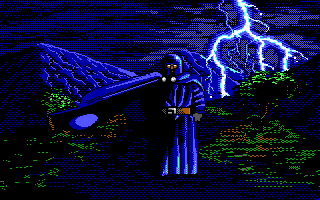
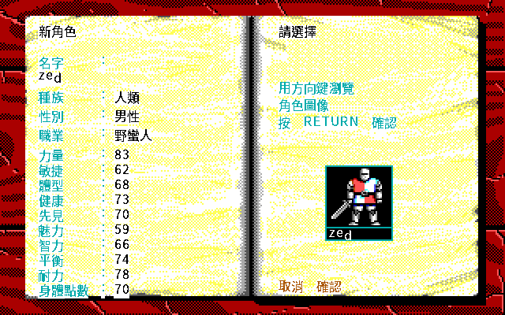
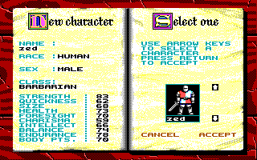
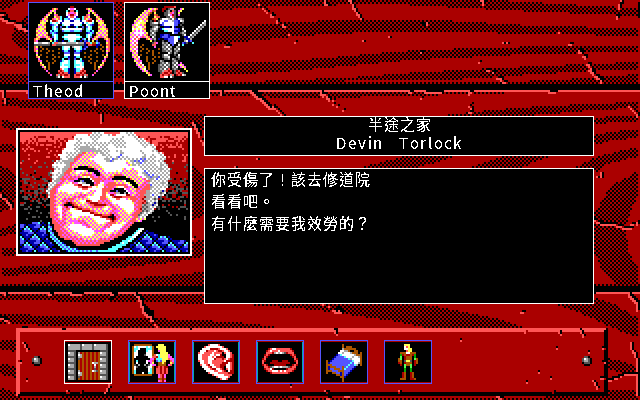

# 《武士傳說》繁體中文重製

這是 Origin Systems *Knights of Legend* 的繁體中文乾淨重寫專案。重製版用 Go 與
Ebitengine，執行期只讀經可重現流程抽出的 PNG；正式音訊使用 Ogg Vorbis。標題雷聲已通過人耳驗收與[正常播放驗證](docs/verification/audio/README.md)。

目前提供標題與書本、建角與名冊、旅店與城鎮、世界探索、戰鬥、任務及結局的實作。
人物保存使用 kol-save-v3，支援舊版匯入。現行交付為 `v.1.0.0-20261011`，
含三平台完整版、需匯入合法資料的 release 與本機推廣影片。正常任務戰鬥逃離、回城住宿保存及新程序重載已完成一次封包抽樣；三平台真機尚未驗收。
繁中角色資料頁的坐騎與六名隊員格、戰後戰利品清單、任務接取與交付對話已有局部正常按鍵畫格；部分編輯與加速功能仍未完成。城鎮來源文字已通過嚴格中文檢查（45 個經逆向判定不以文字顯示的槽位另列清單），手冊功能的整體原版同狀態驗證也未完成。
原版比較採 dosgolem 的固定狀態與可控種子，已驗證的局部規則及畫面各附收據；
完整戰鬥與全程通關的最新正常玩家鏈仍待驗，不以歷史收據宣稱目前全遊戲一致。

**一場戰鬥打得完了**：四個結束條件、打贏打輸逃走三組訊息，以及打贏之後的冒險點數、
金冠與「Items Found:」戰利品清單都實作了（RE-091／RE-096）。敵人傷得夠重會撤退，
兩個門檻讀自怪物記錄——骷髏、殭屍、魔像那幾隻的門檻是 100，永遠不逃（RE-081）。**走在野外會被伏擊**
（RE-078／RE-097…099），**法術也施得出來**（RE-100）。任務的接取、完成旗標、
物品交付、回報與結局觸發已有分段實作（RE-067／101／106…111／139）；
觀察用存檔的接取與交付畫格見[驗證入口](docs/verification/manual-fidelity-audit-20260923.md)。
自然取得任務物品、跨保存及原版完整同狀態仍待驗。
**升級也走得到**（RE-108）：世界地圖上的競技場選一名上場，沒上場的人可以在賭場押他
會贏還是會輸，打贏帳面位階加一。
玩法必須依序通過
「RE 證據 → DRAFT spec → 證據審查 → READY spec」才會進入正式實作。

## 開始遊玩

現行版本為 `v.1.0.0-20261011`，包含已驗收雷聲、資料頁、AI 與任務亂數接續修正。
封包與限制見 [本機交付收據](docs/verification/release-v1.0.0-20261011.md)。
正式交付根目錄為 [dist-all/v.1.0.0-20261011/](dist-all/v.1.0.0-20261011/)：

| 平台 | 檔案 | 開啟方式 |
|---|---|---|
| Linux | [完整版 AppImage](dist-all/v.1.0.0-20261011/full/kol-v.1.0.0-20261011-full-linux-x86_64.AppImage) | `chmod +x` 後執行；沒有 FUSE 可加 `--appimage-extract-and-run` |
| Windows AMD64 | [完整版 ZIP](dist-all/v.1.0.0-20261011/full/kol-v.1.0.0-20261011-full-windows-amd64.zip) | 解壓後開啟 `kol.exe`；已通過 Wine 啟動 |
| macOS ARM64／Intel | [完整版 universal ZIP](dist-all/v.1.0.0-20261011/full/kol-v.1.0.0-20261011-full-macos-universal.zip) | 開啟 `武士傳說.app`；只完成建置與結構驗收 |

`full` 已含遊戲必要資料，只留本機。[release](dist-all/v.1.0.0-20261011/release/) 是三平台引擎包，
需先以包內工具匯入合法持有、已抽取且符合雜湊的資料；說明見各包 `README.txt`。
[64 秒推廣影片](dist-all/v.1.0.0-20261011/promo/kol-v.1.0.0-20261011-promo.mp4)
使用本版抽樣新畫格，也只留本機。檔案與 SHA-256 見交付根目錄的 `SHA256SUMS.json`。
完整戰鬥同狀態、其餘動態中文字、編輯器及加速選項仍有缺口，
目前狀態以 [CONTEXT.md](CONTEXT.md) 與 [工作清單](WORKLIST.md) 為準。

操作照原版參考卡：

| 鍵 | 作用 |
|---|---|
| 方向鍵 | 移動 |
| `A` `S` `Z` `X` | 斜走 |
| `,` `.` | 移動畫面下方圖示列的白框 |
| Enter | 執行 |
| Esc | 回上一頁 |
| Ctrl+Q | 離開 |

滑鼠可以直接點選單、清單與圖示列，右鍵等於 Esc，滾輪上下移動游標。點某一列
送出的是對應鍵盤操作；本專案接受滑鼠替代，只要求玩家操作結果等價。
不同畫面的滑鼠命中與正常玩家流程仍須逐項驗收，不以共用按鍵處理宣稱全部畫面已對拍。

介面預設繁體中文；`-lang en` 切成與原版逐畫面對拍的英文版面。住宿存檔寫在使用者
設定目錄（Linux `~/.config/kol-remake-cht/`、macOS
`~/Library/Application Support/kol-remake-cht/`、Windows `%AppData%\kol-remake-cht\`），
用 `-load <路徑>` 讀回來。

macOS 那一份沒有 Apple 開發者簽章，第一次開啟要在「系統設定 → 隱私權與安全性」
按「仍要打開」，或先執行 `xattr -dr com.apple.quarantine`。Windows 與 macOS
都還沒有真機驗收。

## 目前畫面

完整畫廊見 **[docs/screenshots/GALLERY.md](docs/screenshots/GALLERY.md)**（42 張，英文與中文並排）；產生流程與驗證判準見 [docs/screenshots/README.md](docs/screenshots/README.md)。左欄是**英文
模式**（320×200、原版字模，逐畫面對拍用）；右欄是**繁體中文模式**（960×600、16×18
中文字模格，不對拍）。

| 標題序列 | 繁中：建立角色 |
|---|---|
|  |  |

| 建立角色（英文模式） | 繁中：旅店與組隊 |
|---|---|
|  |  |

這些畫面全部由 `tools/run_kol_shots.sh` 在鎖定容器內重生，`docs/screenshots/MANIFEST.json`
記下每張的產生指令、輸入雜湊與 PNG SHA-256，並要求有對拍收據的畫面與那張逐 byte 相同。

## 專案起源

這個計畫起於華人老遊戲玩家對《武士傳說》的長期記憶：它把細緻的角色建立、紙娃娃
裝備、疲勞與預先規劃攻防帶進電腦角色扮演遊戲，卻也因每回合選項繁多、反覆確認和大型
戰場而顯得非常緩慢。這種「值得保存的深度」與「阻礙今日玩家接近的摩擦」正是重製的
出發點；它們目前只是玩家體驗假說，之後仍須以說明書與原版實玩逐項驗證。

魔旅士在 2010 年 4 月 16 日發表的
[〈Knights of Legend 武士傳說〉](https://morrisjfwong.com/blog/knights-of-legend-%E6%AD%A6%E5%A3%AB%E5%82%B3%E8%AA%AA-dos-game/)
是本專案的重要起源：他記得本作變化多、耐玩、畫面在當年相當出色，也具體描述戰鬥
難度高、普通遭遇可能拖上很久，以及隊伍編成、地形、斥候、逃跑與武器保管等玩家生存
經驗。他還提到自己期待中文使用手冊；這直接支持本專案把完整繁體中文說明書列為主要
交付物，而不只是附帶翻譯。

另一項可回查來源是
[《CRPG 通鑑》中文版〈傳說騎士〉](https://crpgbook.cn/2022/01/01/065-knights-of-legend/)，
該文整理了遊戲的開發背景、細緻世界觀與戰鬥系統，也同樣指出繁複操作和漫長戰鬥的
代價。這些文章說明「值得保存的系統深度」和「值得重新檢視的操作節奏」為何同時存在；
它們屬於玩家觀點與專案動機，不會被直接當成原版規則證據。

## 已確認的原版畫面

以下兩張外部截圖來自魔旅士的原文。它們已和固定原版
`COMBPICS.0` 的解碼結果做配準交叉驗證：左圖對應 archive 圖號 0，右圖對應圖號 1。
這項證據確認場景身分、幾何與方向，不代表 JPEG 與解碼 PNG 逐像素相同；量化結果見
[COMBPICS 視覺 oracle](docs/re/combpics-visual-oracle.json)。

| 戰鬥失利後逃跑（圖號 0） | 競技場戰敗（圖號 1） |
|---|---|
|  |  |

圖片著作權屬原權利人；此處只作研究來源標示與外部引用，不授予再利用或散布權。本專案
另允許已驗證、可重生且有 manifest 的原版衍生 PNG 保存於目前的 private GitHub；這項
專案例外不包含原版 raw 檔，也不授權 GitHub Release 或公開散布。

## 現況與入口

- 私有 GitHub 儲存庫：[wicanr2/kol-remake-cht](https://github.com/wicanr2/kol-remake-cht)
- 專案規則：[AGENTS.md](AGENTS.md)
- 目前真相與交接：[CONTEXT.md](CONTEXT.md)
- 唯一工作清單：[WORKLIST.md](WORKLIST.md)
- 工作歷程：[WORKLOG.md](WORKLOG.md)
- 逆向知識庫：[docs/re/README.md](docs/re/README.md)
- 規格狀態：[docs/spec/README.md](docs/spec/README.md)
- 中文說明書：[docs/manual/README.md](docs/manual/README.md)
- 目前畫面：[docs/screenshots/README.md](docs/screenshots/README.md)

79 頁玩家手冊與 5 頁參考卡已完成繁體中文 Markdown 校對。現行程式涵蓋建角、
城鎮、世界、戰鬥、任務與存讀檔；可玩性、最新正常玩家路徑和原版一致性分開驗收。
目前的實際缺口、證據等級與下一閘門以 [CONTEXT.md](CONTEXT.md) 和
[WORKLIST.md](WORKLIST.md) 為準；舊自評留在工作清單的歷史段落，逐輪進度見
[WORKLOG.md](WORKLOG.md)。

## 授權、致謝與聲明

本專案採**復古重製 source-available 授權條款 1.0（RRSAL-1.0）**，全文見
[`LICENSE`](LICENSE)。**這不是開源授權**——非商業限制不符合 OSI 的開源定義，
正確的說法是 source-available（原始碼公開的專有授權）。

- **非商業用途免費**，不必事先取得同意：使用、重製、散布、修改並散布修改版、
  做其他語言的版本。條件是保留條款全文、標明改了什麼與原始出處、不收費、
  不散布原版素材。
- **實況、影片、評論、報導、論文與展覽明示允許**，而且**平台分潤與觀眾贊助不算
  商業使用**。請署名作品名、作者與儲存庫網址。
- **商業用途要先洽談**：販售、付費或訂閱、隨商品或服務散布、廣告與內購、營利事業
  營運中使用、商業展覽。歡迎來信 <wicanr2@gmail.com>。
- **授權範圍不包含原版的任何東西**：Origin Systems 及其權利繼受人持有原版的執行檔、
  資料檔、美術、音樂、音效、地圖、遊戲文字與商標。本儲存庫裡由原版重生的 PNG、
  原版執行畫面截圖、譯文中保留的原版英文字串，以及由原版量測得出的位址與數值表，
  其中屬於原版的部分仍屬原權利人；條款第 2 條逐項寫明了界線。
- 第三方元件依各自授權：中文點陣字模烘製自 **Noto Sans CJK TC**（SIL Open Font
  License 1.1），執行期使用 **Ebitengine** 及其相依套件。

原版執行檔、資料、美術、地圖、音樂、音效與轉換後素材均受獨立權利限制；
程式碼授權不代表可散布這些內容。
