# 畫面一覽

remake 目前所有的畫面，左邊是**英文模式**、右邊是**繁體中文模式**。

兩個模式是同一個狀態機，只有畫法不同：

- **英文模式** 320×200，用原版字模，逐畫面與原版對拍。
- **中文模式** 960×600，16×18 中文字模格，**不對拍**——原版沒有中文畫面。
  倍率三是算出來的：原版最小行距 6 px，`6 × 3` 剛好等於字模格高（[SPEC-030](../spec/030-cjk-character-sheet.md)）。

表格裡的「—」表示那一側沒有截圖，通常是因為那張畫面在兩個模式下沒有差別，
或者那個情境只在其中一個模式跑過。

每一張都由 [`shots.spec`](shots.spec) 的一行指令重生，不是手動截的；
產生流程與驗證判準見 [README](README.md)。

## 標題序列

遊戲開場。這兩張是原版美術，沒有文字要換。

| 畫面 | 英文 | 繁體中文 |
|---|---|---|
| 暴風雨夜裡的騎士 |  | — |
| 戰士逼近 |  | — |

## 書本

原版的主選單長得像一本書：左頁是內容、右頁是清單。封面與目錄頁上的字是美術不是文字，兩個模式看到的是同一張圖，只有解析度不同。

| 畫面 | 英文 | 繁體中文 |
|---|---|---|
| 封面 |  | 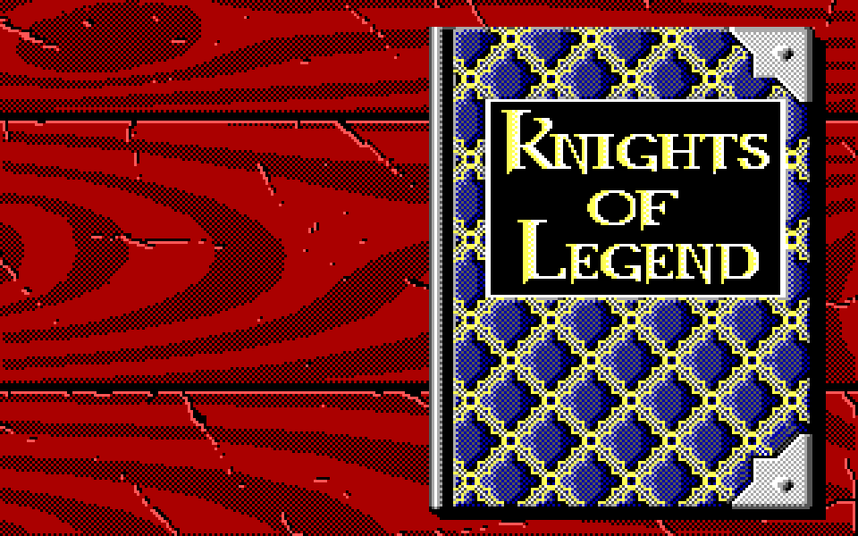 |
| 目錄頁 |  | 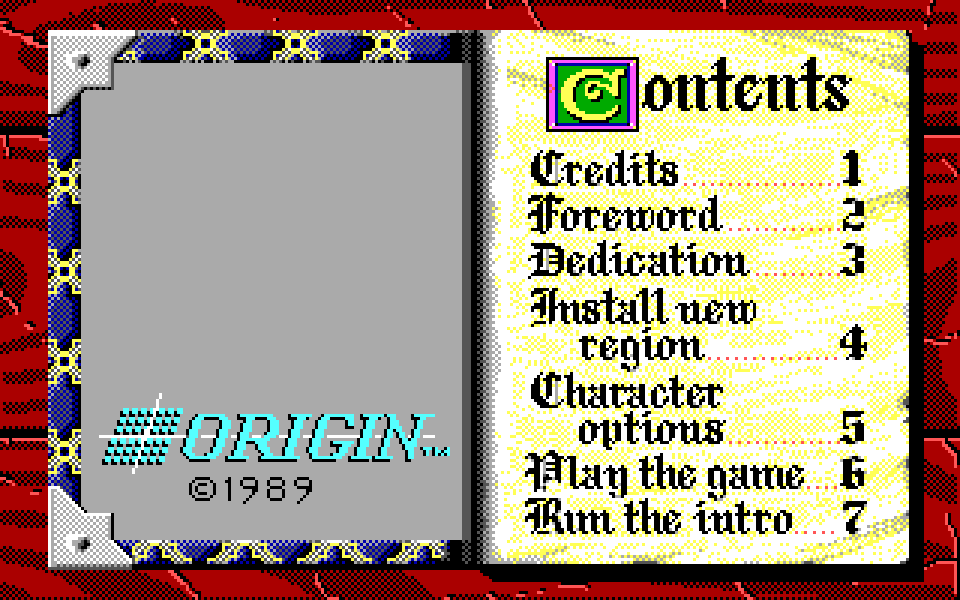 |
| 角色選項 |  |  |
| 角色清單 |  |  |
| 刪除確認 |  |  |
| HARBOR MASTER 訊息 |  |  |

## 建立角色

擲屬性、挑種族職業、選圖像。

| 畫面 | 英文 | 繁體中文 |
|---|---|---|
| 擲屬性 |  | 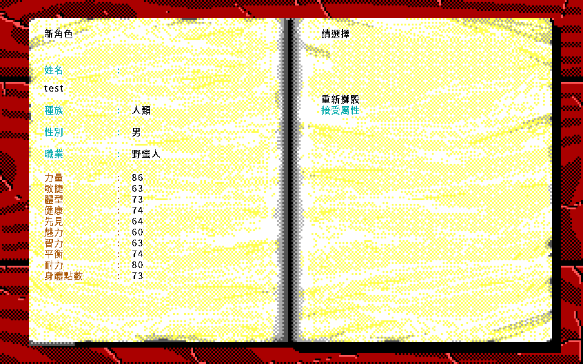 |
| 選角色圖像 |  |  |

## 城鎮

走在城裡、進門、跟人說話。

| 畫面 | 英文 | 繁體中文 |
|---|---|---|
| 戶外地圖 |  |  |
| 走了幾步 |  | — |
| 走到地圖邊緣 | 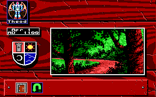 | — |
| 站在門口 |  |  |
| 建築內部 |  |  |
| 鐵匠鋪 |  |  |
| 旅店 |  |  |
| 旅店（兩人隊伍） |  |  |
| Brettle 的旅店 | — | 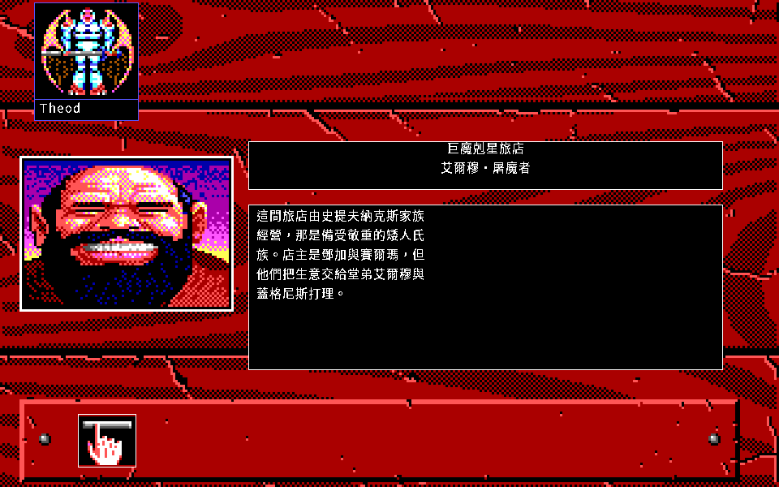 |
| Olanth 的麵包店 | — | 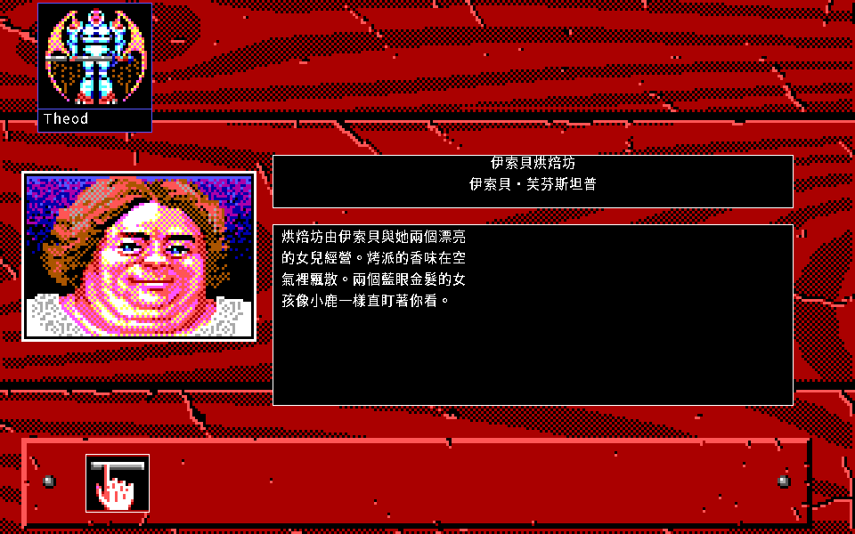 |
| LISTEN：問話 | — |  |
| LISTEN：回答 | — | 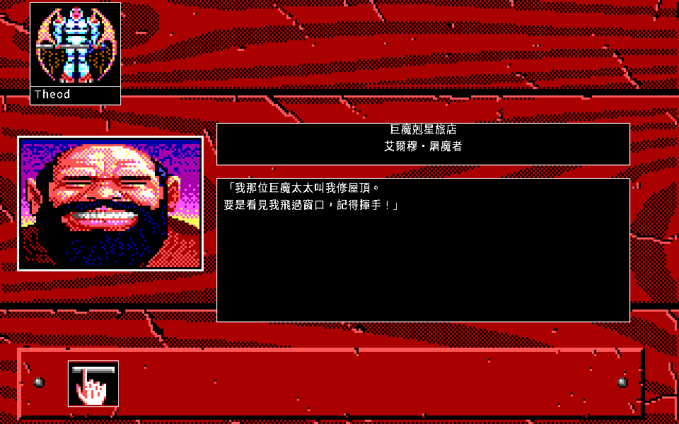 |

## 角色資料頁

旅店的 MIRROR：八個屬性、武器熟練度、金幣與傷勢／營養兩條長條。物品與隊伍立繪是**換頁**不是蓋在資料頁上（RE-126／RE-127）。

| 畫面 | 英文 | 繁體中文 |
|---|---|---|
| 角色資料頁 |  | 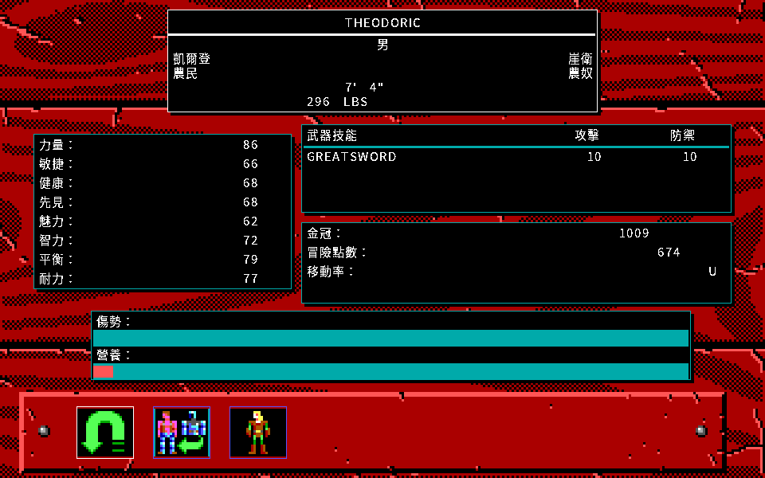 |
| 物品（換頁） | 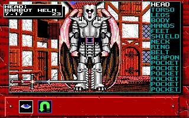 | 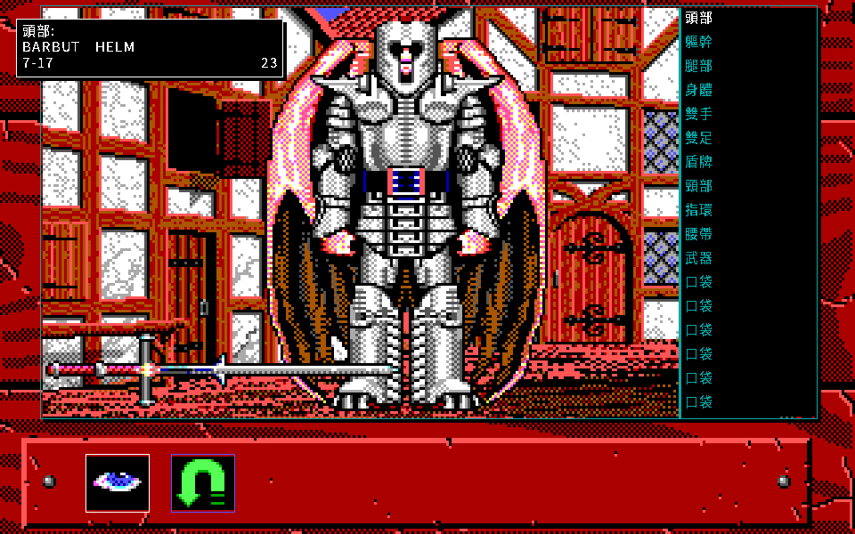 |
| 隊伍立繪（換頁） | 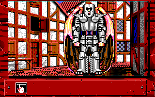 | 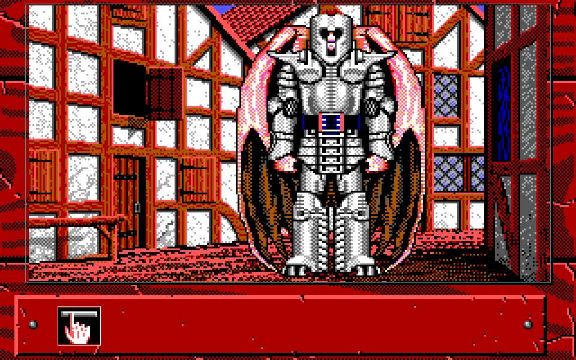 |

## 野外

出了城門之後的世界地圖。

| 畫面 | 英文 | 繁體中文 |
|---|---|---|
| 世界地圖 | 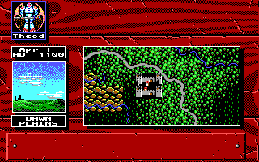 | 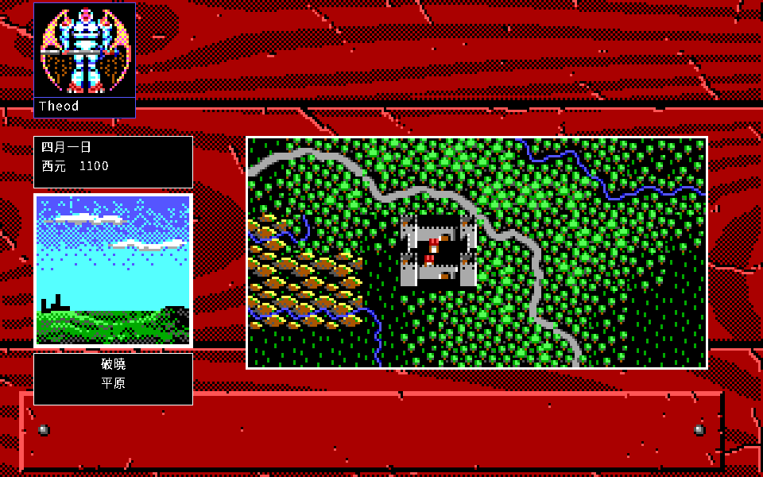 |
| 走到城鎮入口 | 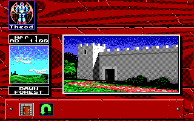 | 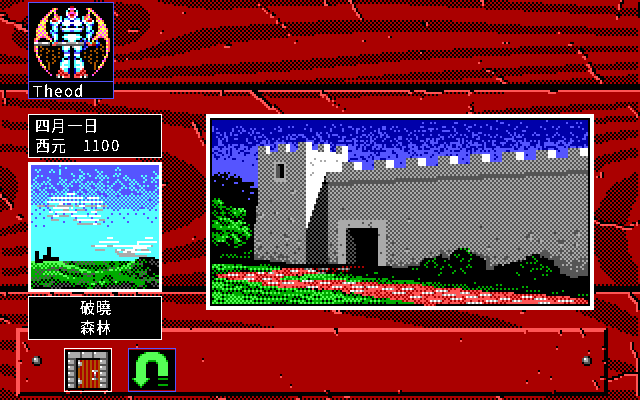 |
