# remake 目前的畫面

## 現行 HD 總覽

首頁的[HD總覽圖](hd-overview.png)使用12張完整遊戲畫格，涵蓋書本、旅店、商店、裝備、城鎮、世界、戰場、傷勢、怪物、天候、事件及F10設定。來源為v.1.0.3-20261017實際AppImage與各批已驗證HD畫格；縮圖保持原比例，不裁掉操作介面。

圖為768×768。逐格來源、畫格與證據清冊SHA-256、拼版工具、字模及輸出SHA-256見[總覽清冊](hd-overview.json)。重現入口為[總覽工具](../../tools/build_readme_overview.py)：在`kol-package:1.26.7-ebiten2.9.9-20261011-r1`容器內，專案唯讀掛`/src`，本目錄可寫掛`/out`，執行`python3 /src/tools/build_readme_overview.py --output /out`。使用UID/GID1000:1000、無網路及有界時間、記憶體、CPU與程序數。

README的EGA／HD比較來自重製程式；原版DOS畫面另標出來源。總覽只展示畫面，不宣稱自然全程通關或原版parity。圖片只適用目前private repo的保存授權。

## 早期 EGA 畫廊與產生流程

更新日期：2026-09-02

**看圖請到 [GALLERY.md](GALLERY.md)**——42 張全部在那裡，英文與中文並排。
這一份講的是它們怎麼產生的。

這裡的每一張圖都由 `shots.spec` 的一行指令重生，不是手動截的。產生流程：

```
tools/run_kol_shots.sh docs/screenshots/shots.spec
python3 tools/build_screenshot_manifest.py
```

`tools/run_kol_shots.sh` 在鎖定映像 `eob-remake-go:1.26.7-ebiten2.9.9-audio` 內起一個
有界容器（`--network none`、2 CPU、3 GB），建置一次、起一次 Xvfb，再逐行跑完整份規格；
算繪走 Mesa llvmpipe 軟體路徑，因此輸出與 GPU 無關。
`MANIFEST.json` 記下每張圖的產生指令、輸入資產雜湊、尺寸、顏色數與 PNG SHA-256，
並就地驗證：解得開、尺寸符合模式、顏色數不少於 4，且**有對應對拍收據的畫面必須與那張
逐 byte 相同**——展示圖不是另外畫一份，就是通過對拍的同一批像素。

## 兩個模式

- **英文模式**（`en-*`，320×200）：原版解析度、原版抽出的 8×6／8×8 字模。
  這是和 DOS EGA 原版逐畫面對拍的模式，收據見 `../verification/remake-parity/`。
- **中文模式**（`zh-*`，960×600）：畫布放大三倍、美術最近鄰放大、文字改用 16×18 中文
  字模格。**這個模式不對拍**——原版沒有中文畫面，版面是 remake 自訂的。

## 標題序列

`TITLE.EXE` 的標題序列已由靜態腳本重播（RE-047）。下面兩張是同一輪展開後的第 66 與
第 89 個畫面。

| 暴風雨夜裡的騎士 | 戰士逼近 |
|---|---|
|  | 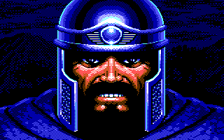 |

## 書本

| 封面 | 目錄頁 |
|---|---|
| 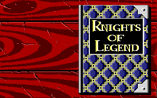 | 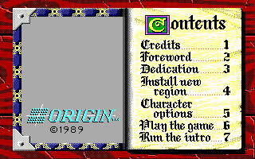 |

| 角色選項 | 角色清單 |
|---|---|
| 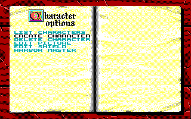 | 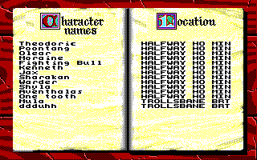 |

| 刪除確認 | HARBOR MASTER |
|---|---|
| 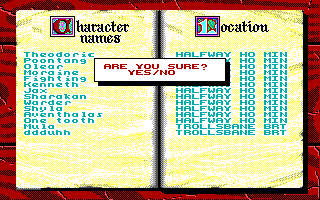 | 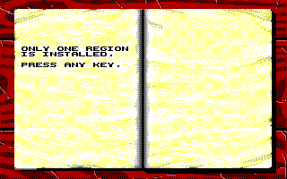 |

## 建立角色

| 擲屬性 | 選角色圖像 |
|---|---|
| 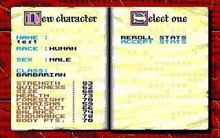 |  |

## 城鎮：半途之家旅店

| 單人隊伍 | 招募一名同伴之後 |
|---|---|
| 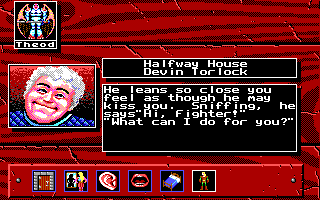 | 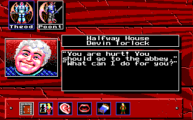 |

## 城鎮：戶外地圖

從旅店按 DOOR 走出來就是布瑞提爾的街道。地圖視窗是 12×6 格、每格 16×16 的捲動磚塊圖，
隊伍是那頂會左右張望的頭盔。隊伍先在視窗內走，走到一定位置鏡頭才跟著捲一格；
DOOR 之類的圖示只在站得上的位置才出現，走開就整格淨空。

| 站在旅店門口 | 往東南走了兩步 |
|---|---|
| 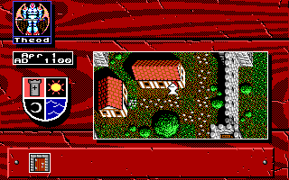 | 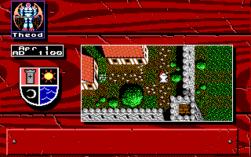 |

走到門的座標上，地圖視窗整個換成那棟建築的門面圖，圖示列只剩 DOOR 與 U-TURN 兩格。
布瑞提爾有 22 個這樣的門，從主城門、守衛室到旅店、武器師與住家都在其中。

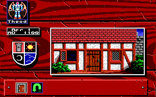

## 城鎮：走進建築

按下 DOOR 就進去了。畫面完全由資料組出來——建築名與人物名來自門座標表、肖像是
`TWN{n}PICS` 的偶數圖號、敘述是 `TOWNn.0` 裡 5-bit 打包的文字。布瑞提爾 21 棟建築
都走同一條路徑。

| 半途之家 | 克瑞卡瓦鐵匠鋪 |
|---|---|
| 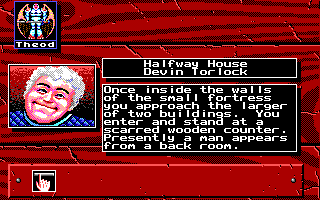 | 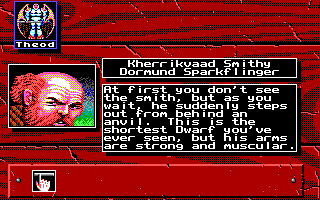 |

七座城 101 棟建築的名稱、人物、進門敘述與建築內對話都已翻成繁體中文：

| 半途之家 | 克瑞卡瓦鐵匠鋪 |
|---|---|
| 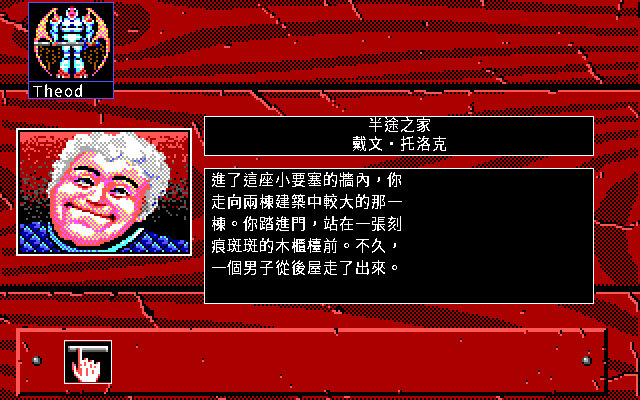 | 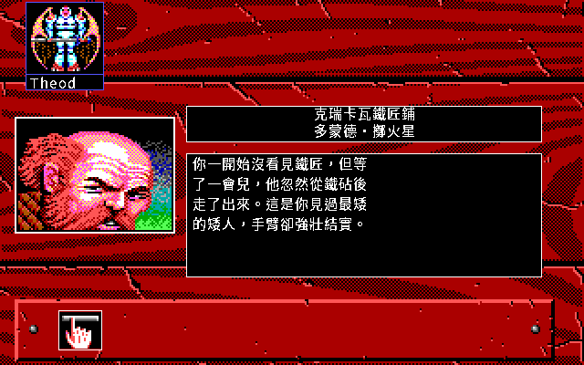 |

## 城鎮：角色資料頁

建築內按 MIRROR 打開的那一頁。畫面上每一個數字都由角色記錄算出來：八個屬性的
畫面值是內部值的三分之二，身高體重查三張表，武器名是 5-bit 壓縮的字串。
整頁與原版逐像素相同，只差原版自己畫的滑鼠游標。

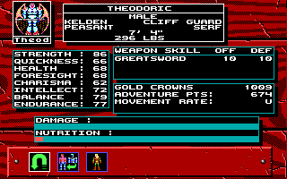

## 繁體中文模式


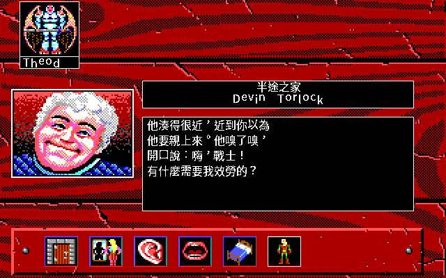

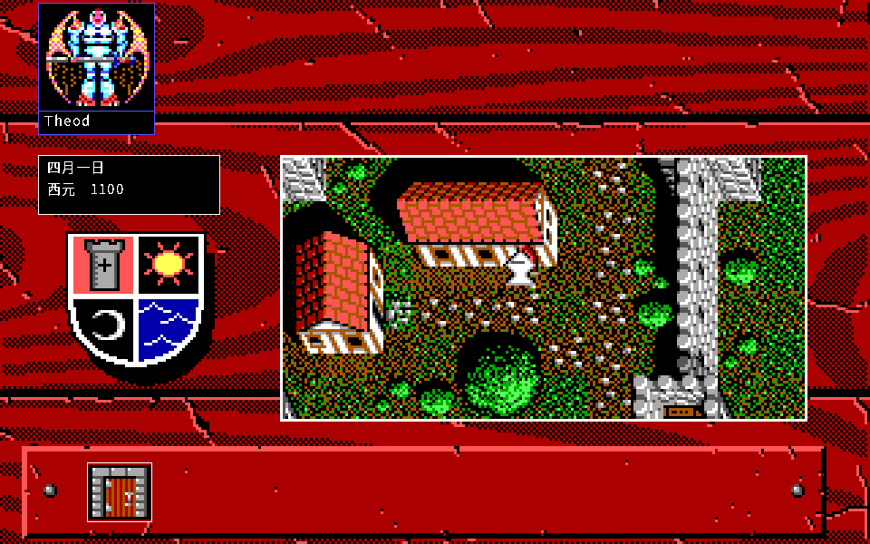

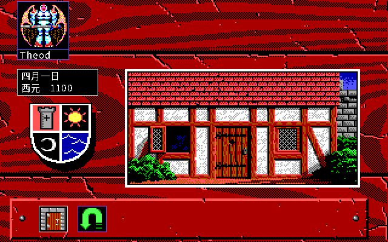

| 角色選項 | 角色清單 |
|---|---|
| 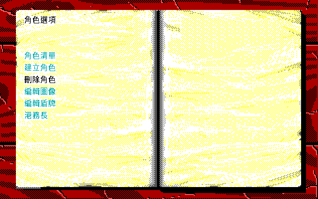 | 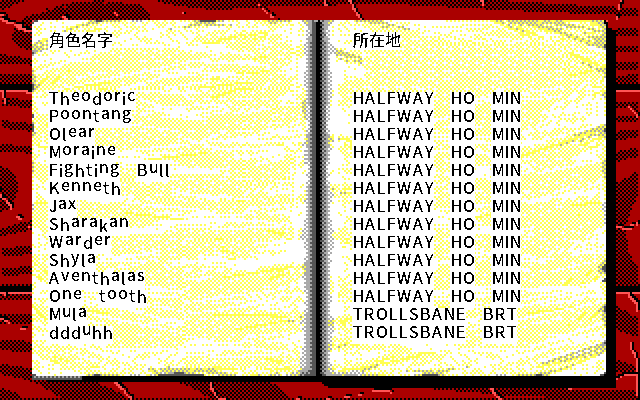 |

| 刪除確認 | HARBOR MASTER |
|---|---|
| 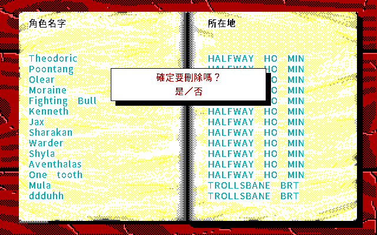 | 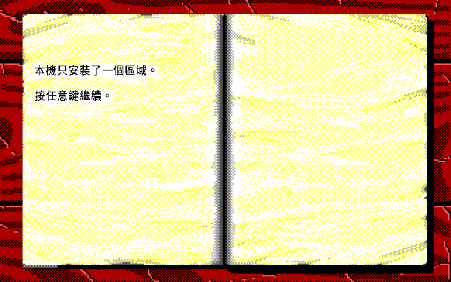 |


## 權利

畫面由 remake 繪製，但內容含原版衍生素材（`BOOKPICS`／`CHARPICS`／`KOLMPICS`／
`TWNxPICS` 等抽出的 PNG）與原版點陣字型，著作權仍屬原權利人。使用者 2026-09-01 的
private-repo 例外只涵蓋 PNG，**不等於公開散布權**；儲存庫轉為 public、建立 public fork、
GitHub Release 或公開 `dist-all/.../release/` 之前必須重新做權利審查。中文字模表另
衍生自 Noto Sans CJK（OFL 1.1），散布時要隨附授權全文。

## 這份收據不宣稱什麼

- 不宣稱遊戲可玩到結局。這些是截圖模式的輸出；接上輸入迴圈的是標題序列、翻書動畫、
  城鎮與野外的走動與對話、招募同伴、住宿存檔與角色資料頁。
- 角色建立頁的中文譯文多為暫譯，狀態記在 `../i18n/newchar-zh-Hant.json`。
- 建築內的買賣、訓練、AWARD、SCROLL 與資料頁上的另外三個圖示都還沒實作；
  戰鬥與任務也還沒有。
- 鏡頭跟隨的確切條件仍是強推論，不是從程式碼讀出來的。
- 角色資料頁只有英文模式，中文版面還沒做。
