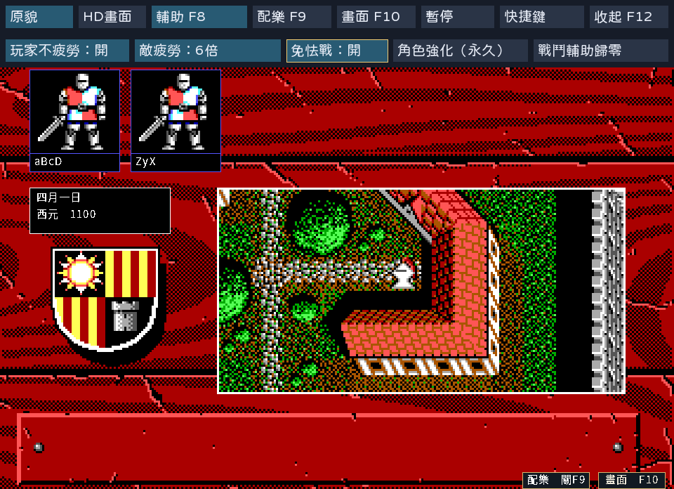
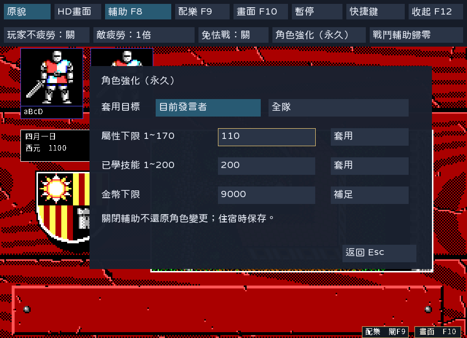
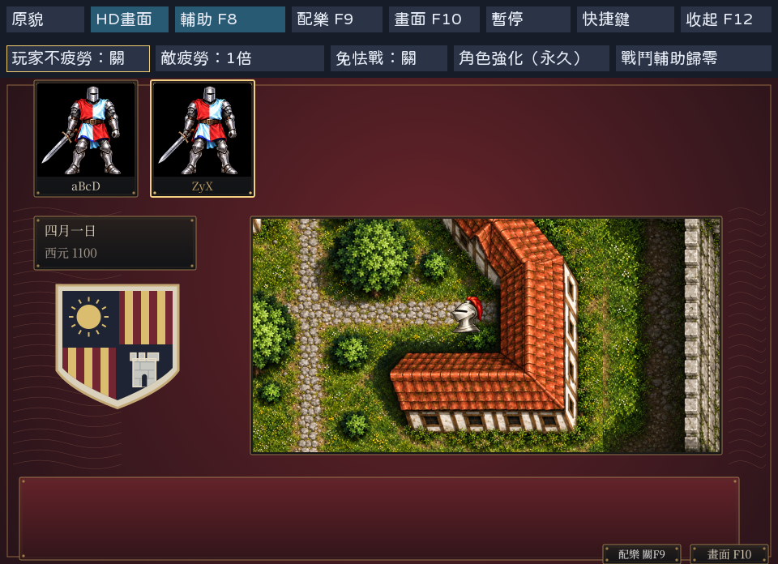

# 工具列與可選輔助驗收

狀態：PASS。範圍為[SPEC-042](../spec/042-assist-toolbar.md)的使用者自訂輔助規則、
上方工具列、永久角色強化及正常住宿保存。此功能已接入目前原始碼；既有
`v.1.0.6-20261024`六個完整版與影片未重建，不包含本功能，沒有新增Release或移動tag。

## 驗證範圍

| 項目 | 結果與證據 |
|---|---|
| 戰鬥規則 | 玩家疲勞清零、不復活；敵疲勞1／2／3／6倍只放大增加量；休息及法術回復不放大；免怯戰跳過檢定，關閉保留擲骰；[測試紀錄](assist-toolbar-20261024/tests.log) |
| 工具列接線 | 同一操作函式供按鈕與快捷鍵使用；測試正式戰鬥狀態同步與歸零；收合不留下隱藏設定頁，F8可重新展開 |
| 永久修改 | 發言者／全隊隔離、七項屬性換算、已學技能及原始值、只補足金幣、非法輸入拒絕、戰鬥中不改寫角色、名冊及完整v3保存往返 |
| 正常玩家路徑 | 正式互動程式建立兩名角色並招募，從工具列修改發言者，再補足全隊金幣；住宿各扣60，保存8940；新程序不帶-load重載，強化保留，戰鬥輔助關閉 |
| 輸入與顯示 | 英文、繁中EGA、繁中HD；設定隔離遊戲鍵及長按方向；原貌／HD切換、F7／F8／F9／F10／F12及返回人物頁；PNG字模缺字與按鈕文字寬度檢查 |
| 偏好 | 缺檔預設、非法內容回預設、數字偏好保存；不保存任何戰鬥輔助啟用狀態 |

完整[收據](assist-toolbar-20261024/receipt.json)記錄453份Go／module／內嵌字模輸入、
執行檔SHA-256、固定seed1、操作序列、十張正式截圖及素材來源清冊。
GUI工具為[verify_assist_toolbar.py](../../tools/verify_assist_toolbar.py)，依正式程式的完成畫格回報
同步輸入，避免HD首次載入期間漏掉驗證按鍵。畫面由X11直接擷取，沒有用原型代替。

## 方法與限制

使用`kol-package:1.26.7-ebiten2.9.9-20261011-r1`，Go1.26.7、Ebitengine2.9.9、
Linux Docker／Xvfb，UID/GID1000、3GiB記憶體、2CPU、256程序上限、無網路。
回歸命令為`xvfb-run -a go test -mod=readonly -count=1 -p 2 ./internal/battle ./internal/town ./internal/font ./cmd/kol`。
正式程式由`go build -mod=readonly -o /out/kol ./cmd/kol`建置，再執行GUI工具的
`--root /repo --bin /out/kol --out /out/gui`；三個路徑分別是唯讀專案、已建置程式及全新輸出目錄。
新輸出不可覆寫既有收據。字型重建入口與固定來源見[SPEC-042](../spec/042-assist-toolbar.md#工具列與設定)。

戰鬥輔助是使用者要求的規則差異，依網友文字說明實作。對方倉庫為空，沒有合併其程式碼。
本次戰鬥數值以規則層及正式狀態接線測試驗證；GUI路徑驗證工具列、角色及住宿，不冒稱
原版oracle、完整自然戰鬥通關或Windows／macOS真機驗收。關閉輔助沿用既有規則測試。
原作衍生畫面依既有公開化決定保存，來源ZIP與原作權利界線保持。

原型、程式候選、完整操作log與保存檔留本機壓縮證據，入口為
[保存清冊](local/assist-toolbar-20261024/retention.json)。本輪工作區在完整核對後清除。
