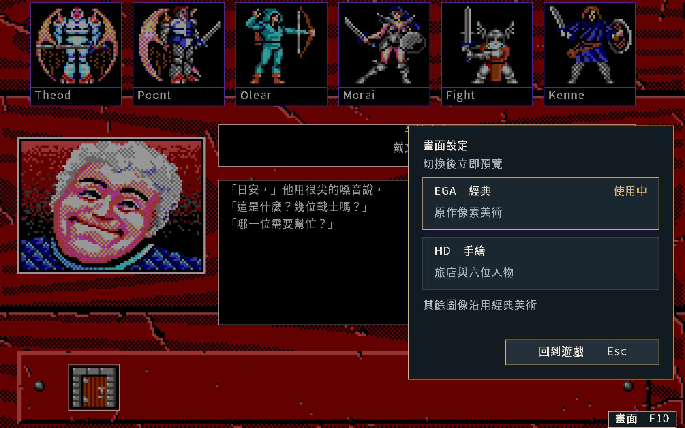

# 遊戲內畫面設定與切換候選

狀態：**候選已驗證，版面待確認**。使用者選定重做畫面設定與遊戲內切換，
在同一場景立即比較，保留已核准人物與旅店美術。
[SPEC-039候選契約](../spec/039-hd-art-ui.md#遊戲內畫面設定候選)維持DRAFT。
本候選使用實際遊戲程式；正式玩家入口尚未接入此面板。

下緣「畫面 F10」或F10開啟右側面板；點EGA／HD立即預覽，方向鍵與Enter也可操作。
Esc、右鍵、F10或「回到遊戲」關閉，留在原場景。切換只影響本次遊玩，不寫入v3保存。

| EGA選單 | 同場景HD選單 |
|---|---|
|  |  |

| 驗證 | 結果 |
|---|---|
| 實際遊戲 | 載入前批真實六人保存，正常進旅店；按鈕、F10、鍵盤及返回可用 |
| 視窗與滑鼠 | 實體1920×1200切換尺寸保持；縮至960×600仍能切換、返回與點第一人 |
| 人物與中文 | 六位肖像均換成匹配HD圖；肖像下方至操作列的場景、姓名及文字區逐像素保持 |
| 輸入與狀態 | 面板內測試1、左右方向鍵；十一個切換事件的場景及隊伍trace雜湊保持，遊戲輸入未洩漏 |
| 保存 | 兩次程序均未寫入指定保存檔，既有v3輸入未改 |
| 缺素材 | EGA啟動後選HD失敗，保留EGA；關閉面板後整張畫面與切換前相同 |
| 中文及安全矩形 | 十二個字串有翻譯；開關、兩種呈現、三種焦點及錯誤提示共48組不超界 |
| 字模 | 2608字的順序與PNG雜湊保持；同步來源清冊雜湊，沒有重生字型圖 |
| 程式 | 正式套件測試通過；新增完整素材原子切換、快取重用及缺件保留畫布測試 |

缺素材提示為「HD 圖片無法使用。」「已保留目前畫面，請稍後再試。」
[實際錯誤畫面](display-switch-20261011/missing-menu-hd.png)已目視核對。
[最初可操作原型](display-switch-20261011/prototype-hd.png)保存提問時的版面。
圖片來源、程式與雜湊見[PNG清冊](display-switch-20261011/manifest.json)。

本機候選為[build/kol-display-preview](../../build/kol-display-preview)，
啟動時在專案根目錄執行`build/kol-display-preview -lang zh-Hant -scale 1`。
這是可重建開發候選，正式v1交付包保持原版本。
建置使用[go_docker.sh](../../tools/go_docker.sh)，GUI驗證在Docker內執行下述腳本；
隔離及掛載規則見[AGENTS.md](../../AGENTS.md)。

完整候選Go來源、驗證腳本、輸入、命令與紀錄保存於
[本機清冊](local/display-switch-20261011/retention.json)。
依[證據保存工具](../../tools/retain_verification.py)的`extract`命令取出後，
在Docker將候選來源放回`workplace/display-switch-20261011/candidate/`，
使用`KOL_GO_IMAGE=kol-package:1.26.7-ebiten2.9.9-20261011-r1 tools/go_docker.sh build -o workplace/display-switch-20261011/kol-display-candidate ./workplace/display-switch-20261011/candidate`重建。
`verify-candidate.py`使用Xvfb與xdotool跑實際滑鼠／鍵盤，`verify-prototype.py`核對最初原型。
工具鏈為`kol-package:1.26.7-ebiten2.9.9-20261011-r1`，Go1.26.7、Ebitengine2.9.9、Pillow及ffmpeg。
驗證容器掛專案至`/src`並以`/src`為工作目錄，設`HOME=/tmp/kol-home`、`DISPLAY=:99`，
啟動`Xvfb :99 -screen 0 1920x1200x24`，等待X socket後執行
`python3 workplace/display-switch-20261011/verify-candidate.py`。
Xvfb須有退出trap；本輪容器限制為2GiB、2CPU、128PID、無網路及外層90秒逾時。

本次只驗畫面設定候選，沒有新增原版parity或平台真機聲明。
圖片只限目前private GitHub；正式入口及版面核准狀態以CONTEXT為準。
