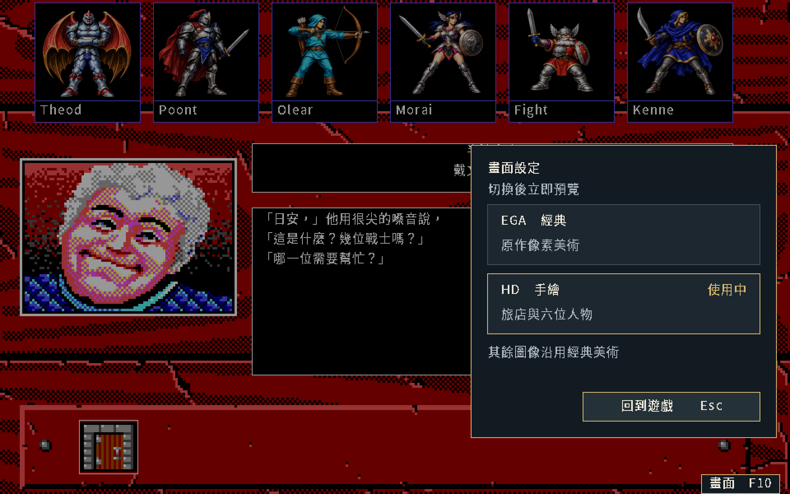

# 遊戲內HD／EGA切換正式驗收

狀態：**通過**。使用者於2026-10-12核准[畫面設定候選](display-switch-20261011.md)並要求開始。
[SPEC-039設定契約](../spec/039-hd-art-ui.md#遊戲內畫面設定)實作前升READY，正式遊戲驗收後升有限CONFORMED。
本次保留核准版面的位置、配色、文字及美術；三張正式截圖與核准樣張逐像素相同。

繁中遊戲點下緣「畫面 F10」或按F10開啟設定，選EGA／HD立即預覽。
方向鍵及Enter可選擇；Esc、右鍵、F10或返回按鈕關閉，留在原場景。
開啟設定時攔截遊戲輸入及自動動畫，Ctrl+Q仍可退出。
切換只在本次遊玩有效，不寫入kol-save-v3；實體視窗尺寸保持。

本機正式來源建置的開發版為[build/kol-hd](../../build/kol-hd)。
在專案根目錄以`build/kol-hd -lang zh-Hant -scale 1`啟動，直接由遊戲內切換。
既有`v.1.0.0-20261011`封包保持原版本；此功能位於目前開發版。

| EGA設定 | 同場景HD設定 |
|---|---|
|  |  |

| 驗證 | 結果 |
|---|---|
| 核准樣張 | EGA、HD及缺素材提示三張正式畫面與候選逐像素相同 |
| 實際操作 | 正常載入六人v3並進旅店；按鈕、F10、方向鍵、Enter、Esc、右鍵及返回按鈕通過 |
| 縮放 | 1920×1200視窗切換尺寸保持；縮為960×600後仍能切換、返回及點選隊員 |
| 圖像與中文 | 六位肖像均換成匹配HD圖；肖像下方至操作列的場景及文字逐像素保持 |
| 輸入與trace | 十五個設定事件的場景及隊伍trace保持；面板內1及左右鍵未傳入遊戲 |
| 缺素材 | 保留EGA並顯示中文提示；返回後完整畫面相同，沒有寫保存 |
| 正常住宿 | 同一舊v3先以EGA住宿，再於新程序切HD後住宿；金幣均953→897，完整v3只差saved_at |
| 新程序重載 | 兩份住宿保存各重載，七個狀態及七張PNG相同 |
| 既有批次畫面 | 前批六人路徑的五張EGA、五張HD及兩份trace保持 |
| 套件測試 | 正式套件及sceneverify適配器／戰鬥通過，包含48種中文設定文字與缺件反例 |

缺素材提示為「HD 圖片無法使用。」「已保留目前畫面，請稍後再試。」
[錯誤畫面](display-switch-runtime-20261012/missing-menu-hd.png)已核對。
圖片來源、畫格、雜湊與權利分類見[PNG清冊](display-switch-runtime-20261012/manifest.json)。
[收據](display-switch-runtime-20261012/receipt.json)索引程式、輸入及輸出雜湊。

建置沿[go_docker.sh](../../tools/go_docker.sh)：

```sh
KOL_GO_IMAGE=kol-package:1.26.7-ebiten2.9.9-20261011-r1 \
  tools/go_docker.sh build -o build/kol-hd ./cmd/kol
```

[verify_display_switch.py](../../tools/verify_display_switch.py)為正式GUI驗收入口。
在Docker掛專案至`/src`、本輪工作目錄至`/out`，工作目錄為`/src`；
`/out/kol`為正式建置程式，`/out/inputs`包含`save.json`、`party6.json`與`stay-v3.json`。
三份輸入由前批已核對封存取出，雜湊保存在本輪收據，不另抽亂數。
固定seed1，啟動1920×1200的Xvfb後執行`python3 tools/verify_display_switch.py`。
工具鏈為`kol-package:1.26.7-ebiten2.9.9-20261011-r1`、Go1.26.7、Ebitengine2.9.9、Pillow及ffmpeg。
容器無網路、UID/GID1000、2GiB、2CPU、128PID及外層120秒逾時；Xvfb有退出trap。

首輪住宿自動化漏收一次短按鍵，保留失敗紀錄；改為跨畫格按下及放開後同命令通過。
產品程式沒有因此修改。完整紀錄依[保存流程](retained-evidence.md)封存至
[本機清冊](local/display-switch-runtime-20261012/retention.json)，核對後清理本輪工作區。

本收據只確認遊戲內畫面設定、所列旅店畫面及保存路徑，不新增原版parity或平台真機聲明。
其他HD美術依原批次繼續；PNG只限目前private GitHub。
