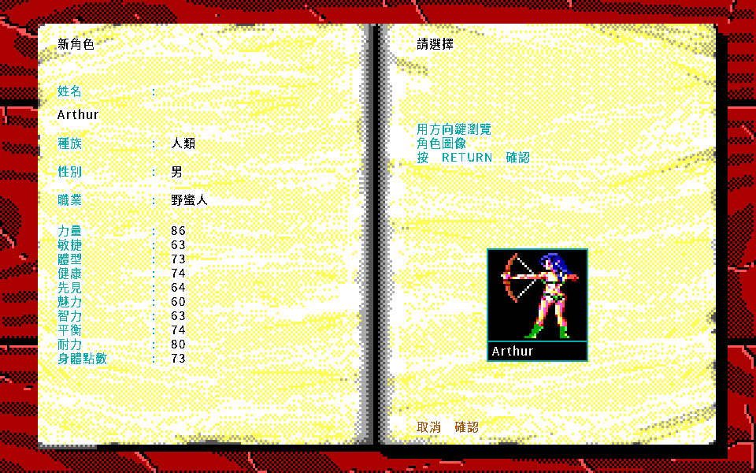
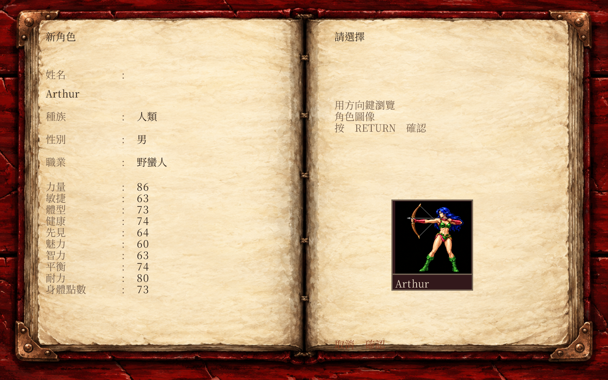
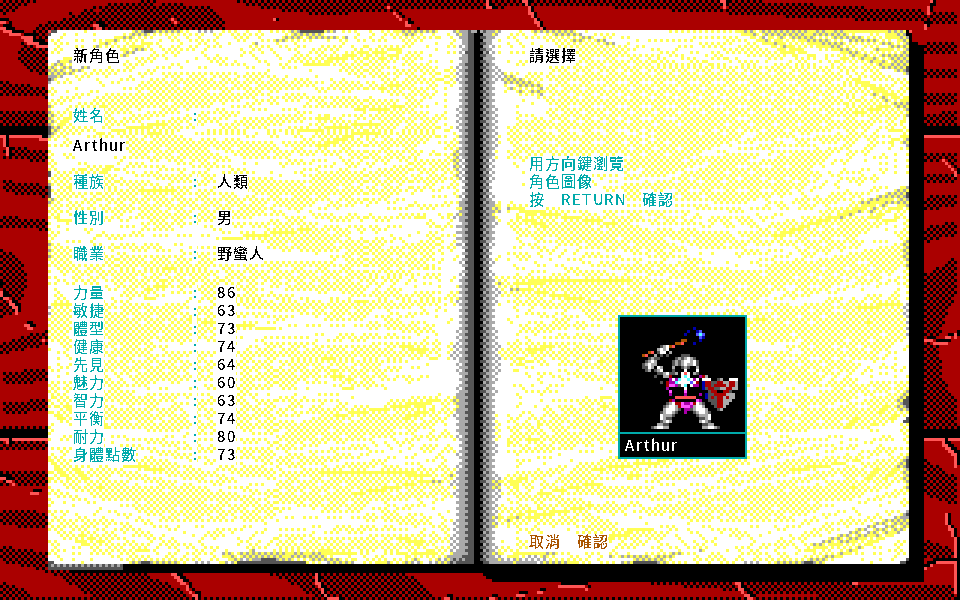
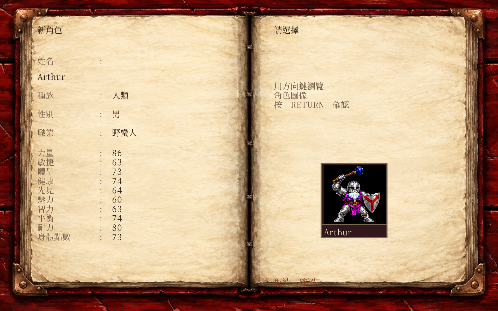
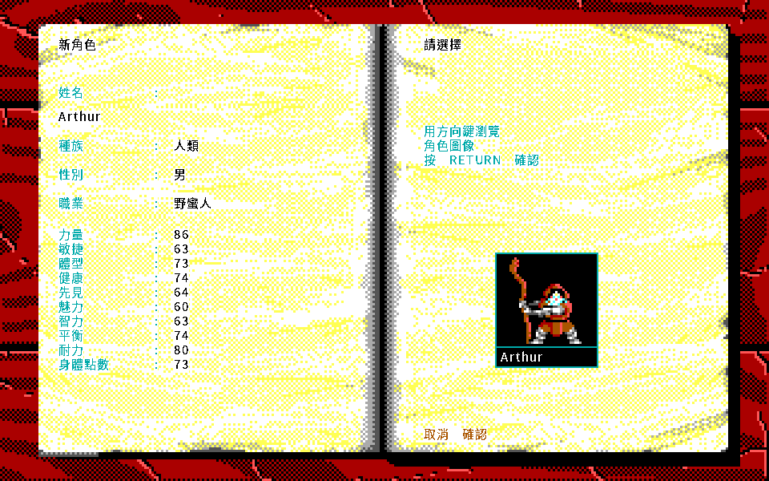
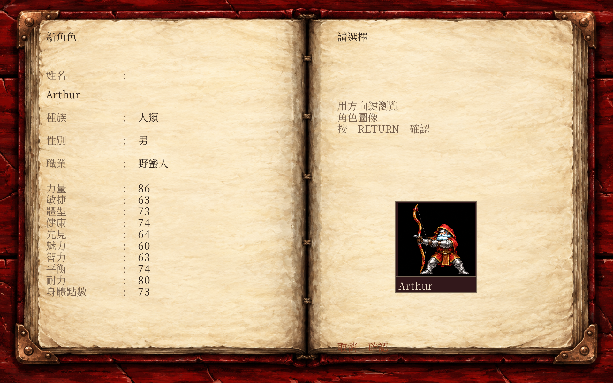

# 角色模板 HD 驗收

日期：2026-10-14。狀態：SPEC-039 本批有限CONFORMED，正式接入已驗。

本批補齊原版 `CHARPICS` 的80張角色模板。原核准六圖保留，新增74張同畫風手繪圖，放在二十張圖集內。人物裝備合成、其他NPC、坐騎、怪物及地圖不在本批完成範圍。整體全畫面HD仍開放。

## 來源與呈現

| 項目 | 核對結果 |
|---|---|
| 原版輸入 | `Knights-of-legend.zip`，SHA-256 `2b455e3c13ec7ecb727c918eefbe261fe741a460285bdd0e638a6aeb6ec49f46` |
| archive | `Knights-of-legend/CHARPICS`及`CHARPICS.0`；實際80個payload、80張40×38 PNG、80個不同RGB指紋 |
| 保留圖號 | 47、43、21、32、35、54，沿原核准順序 |
| 核准圖集 | `party-painted-v1.png`，SHA-256 `77e3d3e3a00dfe6144fe278eeda6c2b28b414e470f9ffb2033dfedc8c97cf016` |
| 新圖 | 二十張四人格，74格使用，最小原生畫格560×532；沒有升頻冒充原生細節 |
| 工具 | 內建`image_gen.imagegen`；Pillow只做清冊、分格及驗證，不重畫PNG |
| 執行期 | 原生PNG圖格等比置中於原頭像框；來源依圖號與RGB匹配，不用角色名字 |
| 權利 | 僅本機及目前private儲存庫；沒有公開散布權 |

原版像素及索引來源已驗。武器細節與臉部是手繪詮釋，不宣稱原版逐像素或裝備數值parity。二十組提示詞、原始輸出、三組修正版、來源及每格雜湊保存在本批素材清冊與本機證據。

## 隔離原型

基底為5348a8bc的376份Go／module來源，候選為380份。使用Go1.26.7、Ebitengine2.9.9與`kol-package:1.26.7-ebiten2.9.9-20261011-r1`，全程Docker、UID/GID1000、原版輸入唯讀、無網路。

| 驗證 | 結果 |
|---|---|
| 素材載入 | 二十PNG、74新增／6保留來源完整；十二種無效綁定拒絕載入 |
| 正常入口 | 標題、封面、目錄、角色選單第二項、姓名、屬性、選圖；固定seed1 |
| 頭像循環 | 98個控制器狀態，80個索引與回捲；81張實際HD頭像與獨立CPU取樣最多一色階 |
| EGA與中文 | 81張EGA相同；控制器追蹤及中文文字集合相同 |
| 核准六圖 | 首次完整畫格保持；姓名牌修正另列意圖差異，角色圖片保持 |
| 姓名牌 | 改淺色字；16字元完整縮放於原框，短姓名相同，姓名欄外零差 |
| 真實視窗 | 短姓名及16字元姓名各24個F10事件；完整建角欄位保持，鍵鼠及兩視窗通過 |
| 畫格往返 | 每輪三組靜止完整畫格最多一色階；姓名輸入閃爍游標以完整緩衝核對 |
| 保存 | 正常新增第79張頭像角色，98狀態；v3的`characters[14].portrait`為79 |
| 重載 | 同一v3由基底EGA、候選EGA與候選HD各重載5狀態，追蹤相同，原檔SHA保持 |

正常追蹤格式沒有建角欄位，所以80張選圖另以實際像素證實，GUI另記錄完整建角欄位雜湊。沒有把原追蹤摘要誤當完整建角狀態。

建立角色使用隨機UUID。本批只建立一次並重載同一檔案，不宣稱跨次UUID相同，也不改正式亂數。沒有原版RND、自然通關或Windows／macOS真機驗收聲明。

## 正式接入

七份Go檔案及二十張PNG已依READY規格接入，所有380份來源與候選相同。正式程式亦與已驗最終原型逐位元相同，SHA-256為`2d31dc2cc746346909626b31bf2921ec03f053997fedfd1019b7b66ffd66d8ef`。全套及sceneverify測試通過。

正式每側98狀態，抽驗二十個四人圖集與原核准六圖，共52張畫格；EGA零差，HD與候選最多一色階。16字元姓名保持完整，既有旅店與戶外畫格保持。正式新增第79張頭像角色後寫v3，再以EGA及HD各重載5狀態，原檔SHA保持。

正式真實視窗24個F10事件通過，包含8字元緩衝、完整16字元姓名、一般與核准頭像，以及小視窗有翼頭像。完整建角欄位由獨立診斷核對，三組靜止完整畫格最多一色階，鍵鼠與兩視窗通過，草稿未保存。

素材清冊只將status從READY改為CONFORMED，PNG及所有呈現欄位保持，載入器不讀status。前後雜湊見[metadata-status.json](hd-character-templates-20261014/metadata-status.json)，正式清冊SHA-256為`5fe92d61fa1f8c6d7f6aaa3bd501fdbd7662e74fae534dd7c7fd3718a04ddd90`。

| 重製中文 EGA | 同狀態 HD |
|---|---|
|  |  |
|  |  |
|  |  |
|  |  |
|  |  |

EGA是使用原作美術的重製中文介面，不是原版DOS執行截圖。另有[比較頁](hd-character-templates-20261014/review.html)、[截圖清冊](hd-character-templates-20261014/manifest.json)、[正式收據](hd-character-templates-20261014/receipt.json)、[80張像素核對](hd-character-templates-20261014/prototype-all80.json)與[F10收據](hd-character-templates-20261014/formal-gui.json)。

## 工具失敗與保存

隔離快照缺少docs fixture、UI依賴assets違反分層、角色選單第一項誤認為建立角色、快速送字同幀合併與大寫、存檔格式欄位誤認為version、複製程式遺失執行位元，皆保留原輸出並依原因修正。沒有放寬正式一色階或分層判準。

圖集曾出現多餘弓弦、桶狀盾牌及過近間距，修正版另存。16字元姓名原本超框，原畫格與量測保留。完整typed data、存檔與GUI建角JSON僅本機，不提交。

原工作區`workplace/hd-character-templates-20261014/`已於2026-10-15逐檔重驗後清理。1325份檔案保留，七份可重建執行檔只留雜湊；壓縮檔460399808 bytes，SHA-256為`bb4874024c7cd14c97338e077cb55c8747f37f0a8745720d393e1846d84dd534`。解開及核對沿[保存入口](retained-evidence.md)與[本機清冊](local/hd-character-templates-20261014/retention.json)。一般歷程見[WORKLOG](../../WORKLOG.md)，目前目標見[CONTEXT](../../CONTEXT.md)，規格見[SPEC-039](../spec/039-hd-art-ui.md#角色模板續作)。
