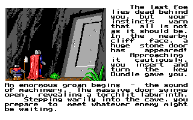

# 全畫面 HD 盤點與事件候選

狀態：盤點與原候選保存。第0段已獲核准，七段結局已[接入開發版並有限驗收](hd-ending-runtime-20261014.md)。使用者要求所有操作介面、圖形與事件畫面 HD 化。
沿用1920×1200、手繪、紅黑銅框及遊戲內 F10。現行 v.1.0.2-20261013 只有部分 HD，不能宣稱全部完成。
範圍與接入閘門見 [SPEC-039](../spec/039-hd-art-ui.md#全畫面-hd-續作與事件候選)。

## 目前覆蓋

重算804張輸入 PNG 的雜湊、尺寸與格式，沿 RE-294 分類為748張圖片、11張顯示圖集、3張字型圖集、36張渲染／地圖資料及6張結構遮罩。
這是素材分類，不能拿804當作手繪完成率的分母。[coverage.json](hd-completion-20261014/coverage.json)保留開工時的程式與素材雜湊，不覆寫歷史快照。下表依後續開發版驗收更新，發行包仍為v.1.0.2-20261013。
書頁與服務介面見[原生HD驗收](hd-native-ui-runtime-20261014.md)，法術頁見[卷軸驗收](hd-spell-scroll-runtime-20261014.md)，八十張角色模板見[本批驗收](hd-character-templates-20261014.md)。
完整物品17槽、六型隊伍、裝備與預設盾面已[正式接入並有限驗收](hd-equipment-runtime-20261015.md)，68個動作圖示亦[獨立接入](hd-actions-runtime-20261015.md)。原型354案例及各階段失敗仍保留原範圍，不能反向當作正式全組正常操作證據。
開工分類將KOLMPICS第28圖列入圖片，後依RE-012確認為城鎮徽章AND遮罩。現行分類訂正為747張圖片及7張結構遮罩，其餘不變；804張來源與歷史coverage.json雜湊保持。

| 畫面 | 現行 HD 狀態 | 需要完成 |
|---|---|---|
| 片頭與翻書動畫 | 未完成 | 重繪每幀並核對順序、時間、雷聲與配樂；切換不推進動畫 |
| 書本、目錄、角色選項與名冊 | 原生書頁與選項已有限驗收 | 封面、序文、製作名單及翻頁動畫；其他未訪文字邊界 |
| 建立角色與自訂圖編輯 | 80張模板及原生操作已有限驗收 | 自訂40×38點陣內容保持；其他創角規則邊界仍依原未決項 |
| 旅店與標準建築對話 | 部分完成 | 其他 NPC、超過九行、輸入游標、多段對話與各種服務分支 |
| 商店、訓練、馬廄、法術與任務子頁 | 清單、確認及法術卷軸已有限驗收 | 其他NPC、坐騎、裝備圖形與未訪服務分支 |
| 人物資料、技能、裝備、法術與任務清單 | 基本資料、法術／任務清單及完整物品17槽／隊伍頁已有限驗收 | 其他長名稱與未訪操作分支；68個動作圖示及完整裝備頁已完成本批有限驗收 |
| 人物、NPC、怪物、坐騎與組合裝備 | 80張角色模板、旅店及三個服務頭像已有限驗收；六型裝備、28武器、四盾及預設盾面匹配已正式接入並有限驗收 | 其他NPC、怪物與四坐騎；其餘未抽測組合及操作分支 |
| 城鎮、建築門面與城門 | 部分完成 | 七城其餘門面、圖像中文字、城門、走路標記與各種天候 |
| 世界探索、地圖、天候與野外提示 | 未完成 | 所有地形、城鎮入口、換日、任務地點、遭遇、騎走與天候圖層 |
| 戰鬥主畫面與操作分支 | 部分完成 | 戰場、敵人框、選格／目標、攻防與移動選項、指令圖、執行／結果 |
| 傷勢、法術、效果與標記 | 未完成 | 手繪人形與可追溯部位遮罩一起驗，選格和傷害部位保持 |
| 事件、戰鬥結果與七段結局 | 七段結局已接入開發版並有限驗收；其他事件未完成 | 其餘事件依原版 DOS／重製 EGA／手繪 HD 分開截圖，每段中文完整，事件次序與按鍵一致 |
| 畫面與配樂設定 | 核准範圍完成 | 新增各場景都須沿用同一切換，事件段號／隊伍／游標／保存不變 |

## 事件比較

[比較頁](hd-completion-20261014/review.html)提供原版 DOS、現行重製 EGA 與隔離 HD 候選；畫面包含結局內容。

| 原版 DOS 第0段，320×200 | HD 候選第0段，1920×1200 |
|---|---|
|  |  |

原版由固定 dosgolem 968ca774 執行原始 KOL.EXE 啟動至旅店，再受控呼叫原版 sub_2B4A7。
七次等待仍執行原程式，各送一次 Space，七張圖片矩形與經驗證的原版 PNG 完全相同。
呼叫前 DS:1600／1602 設 seed1，結局段亂數呼叫0次；沒有重擲或挑選結果。
這次原版為白底黑字，現行重製為黑底白字；受控入口不證明最終戰鬥自然進入時的配色狀態，也不宣稱整頁 parity。
原版缺少 region1…4 屬既有未安裝擴充區域，結局素材均成功載入，未實作服務0。
[原版收據](hd-completion-20261014/original-receipt.json)明列方法、畫格、呼叫端與限制。

以下保存初次候選的範圍；後續七段正式接入見本頁開頭連結。
原始HD候選只重繪第0段，保留兩人背影、巨石門、事件次序與真實譯文。
插畫1448×1086，按原圖框等比縮放置中；圖框與文字使用原座標乘六，不更動翻頁或任務規則。
原生中文字沿用核准字模、32px、象牙白及銅色外框；逐段檢查缺字、畫布界線及圖片重疊。
其餘六段尚未手繪，維持現行顯示，不列為 HD 完成。
完整提示與生成工具路徑見 [imagegen-prompt.txt](hd-completion-20261014/imagegen-prompt.txt)，來源、尺寸及 SHA-256 見 [manifest.json](hd-completion-20261014/manifest.json)。

## 候選驗證

- 隔離副本新增事件呈現及受控互動入口；正式363份 Go／module 輸入雜湊保持。
- 現行版七段英文／繁中及候選七段均擷取；第0段候選中文完整，圖片與文字無重疊。
- 真正 Ebitengine 視窗在1920×1200與960×600完成四次 EGA／HD 切換，共十二個設定事件；事件段號與狀態雜湊全部保持。
- HD 切回後完整畫格逐通道最多一色階，符合原訂閘門；差異限下緣設定字緣，事件圖文保持。Ctrl+Q 正常退出。只驗 Linux 容器，未宣稱 Windows／macOS 或正常通關。

[候選收據](hd-completion-20261014/candidate-check.json)與[正式輸入清冊](hd-completion-20261014/production-inputs.json)保存結果。
原版與候選均屬受控展示。組隊、商店購買及正常玩家路徑沿既有[商店收據](player-path/town-shop-receipt.json)與[版本交付收據](release-v1.0.2-20261013.md)，
從新開局正常完成全部任務至結局仍未驗證。

## 下一閘門

使用者已於2026-10-14確認第0段新畫風及沿原圖框的事件素材契約，七段已升READY、接入及有限CONFORMED。
後續按「事件及結局 → 書本／建角／商店等操作頁 → 其他人物及裝備 → 城鎮／世界／戰鬥／天候」分批續作。
每類須附實際中文畫格、操作與 F10 狀態保持證據。所有可見圖形與子頁完成前，本項保持開放。
舊自訂圖與傷勢遮罩先展示相容方案，不更改 v3 或用未證實的圖層契約補洞。
所有截圖及候選僅供目前 private 儲存庫審查，原始 ZIP／EXE／archive 不加入 Git 或 Release。

## 重生與封存

比較腳本、原版鎖版來源、候選覆蓋檔、輸入清冊與失敗紀錄已存入
[本機保存清冊](local/hd-completion-20261014/retention.json)。107份檔案保留，兩份可重建執行檔只保存雜湊。
解開與核對方式見[證據保存入口](retained-evidence.md)，名稱為 `hd-completion-20261014`。
原始工作區核對後清理；恢復本批時沿來源基底873284a8及363份輸入清冊，使用同一鎖版 Docker image。
解出的 `capture-original.sh` 重生原版七段；`build-candidate.sh` 在容器暫存副本建置；
`capture-candidate.sh` 擷取及驗證候選。這些是候選／受控展示工具，不加入正式遊戲路徑。
