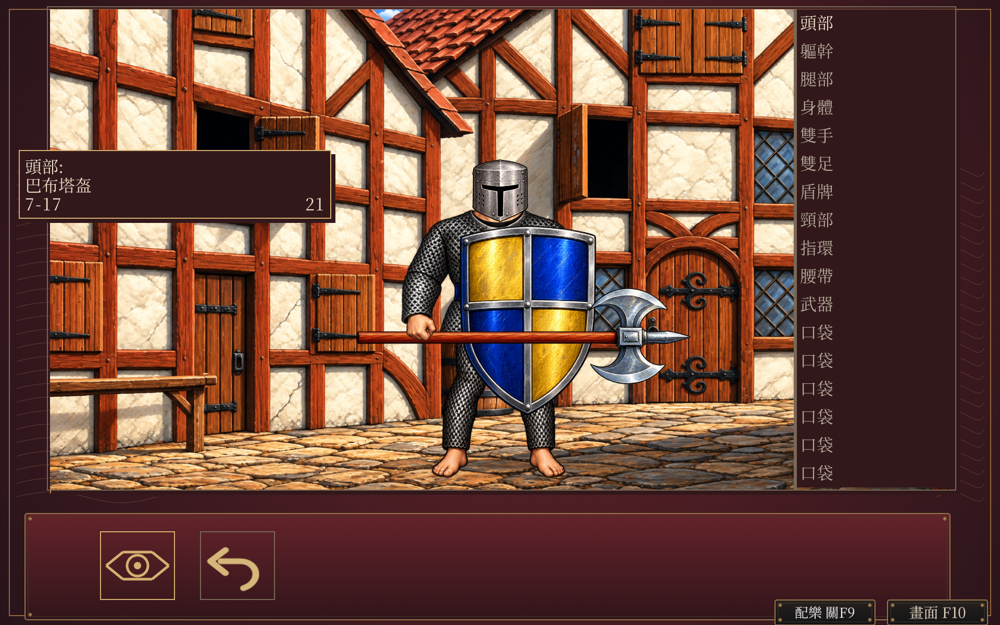
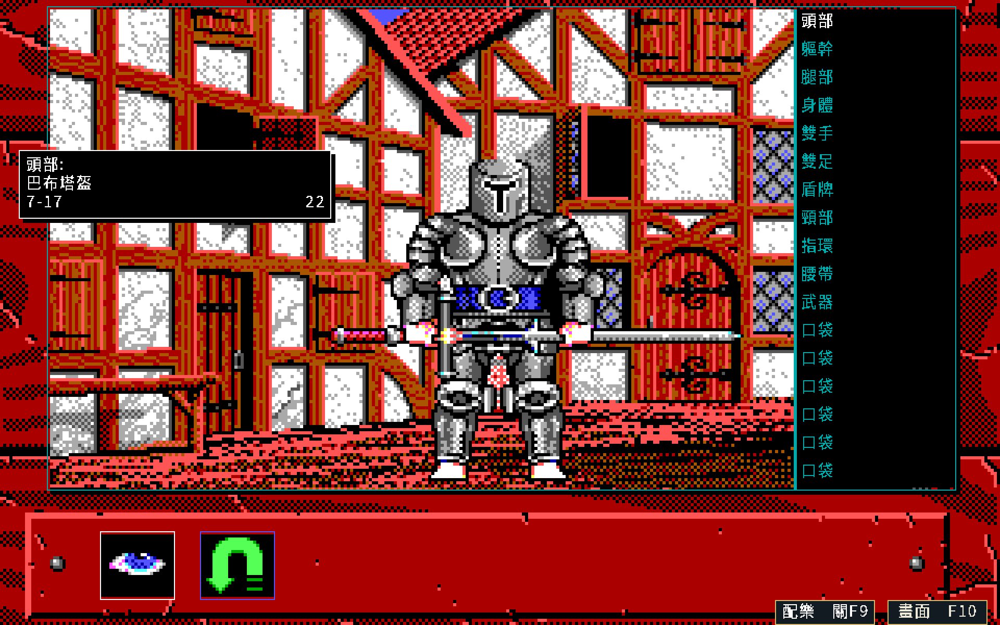
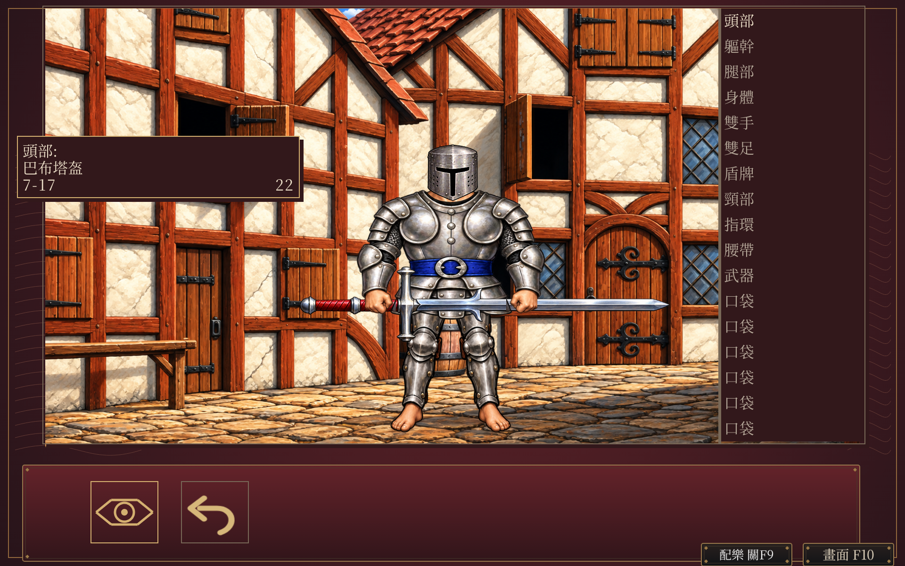
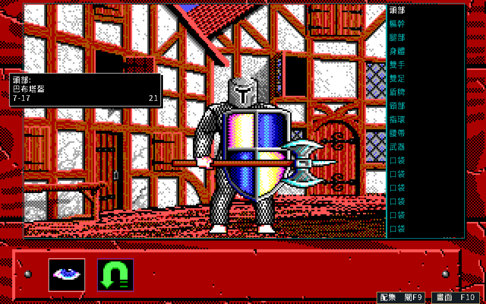
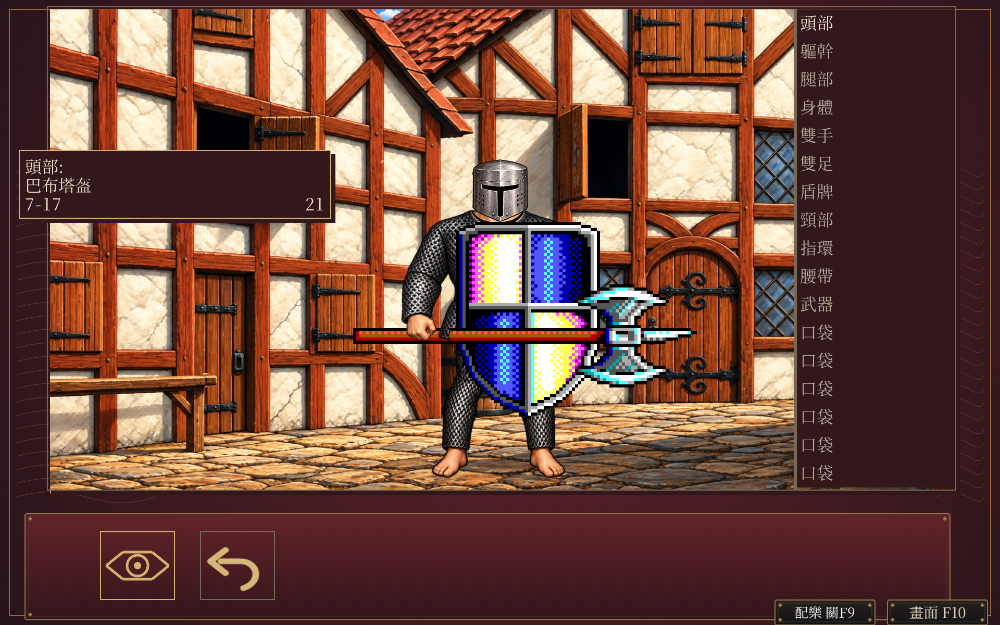
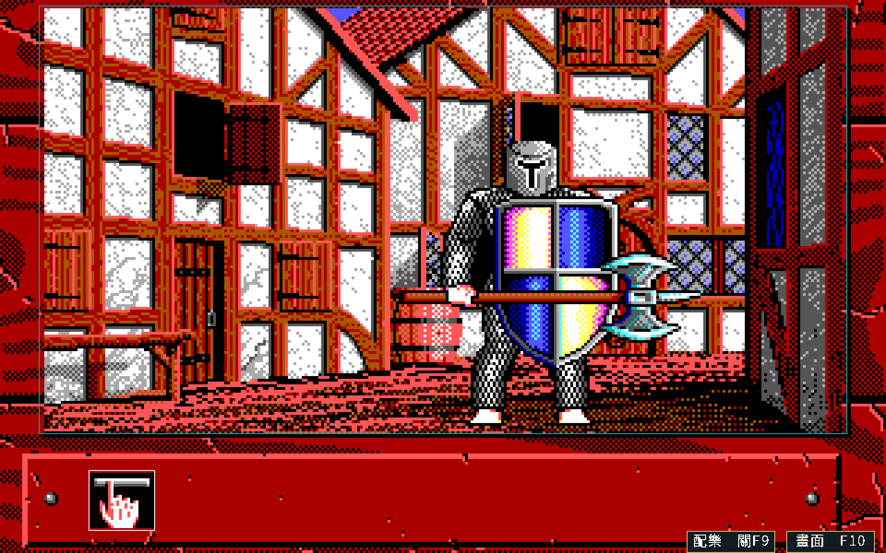
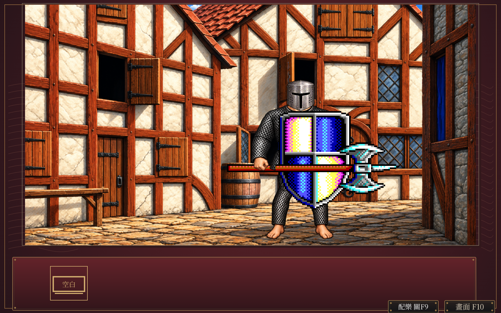

# 完整物品／隊伍頁 HD 原型

狀態：**DRAFT**。本批是隔離原型，正式程式及現行`v.1.0.2-20261013`發行包保持。
全畫面HD仍在續作，範圍以[SPEC-039](../spec/039-hd-art-ui.md#完整物品隊伍頁與裝備原型)及[13類覆蓋表](hd-completion-20261014.md#目前覆蓋)為準。

原型沿已核准手繪、1920×1200、紅黑銅框與原操作位置，將完整物品頁、隊伍頁及中文文字原生繪製。
六種身體底圖、六種體型共162款頭部／上身／下身、城鎮與野外背板及四盾候選已產生。檢視與空白鍵圖示沿現有介面風格繪製。
v7隔離遊戲已接入六種體型、28款武器及四盾。最新v9單檔覆蓋修正盾面與上身網格取樣；以下先列受控合成，再保存v7正常操作及早期候選。全部動作圖示與正式接入仍開放。

## 成套、卸裝、混搭與護具合成

[合成檢視](hd-equipment-pages-20261015/matrix-review.html)保存六型外觀、三款獨立護具與盾面修正前後。接觸表由實際中文物品頁畫格裁取，沒有以CPU示意代替遊戲繪製。這批使用合成fixture，不作正常玩家路徑聲明。

| 檢查 | 結果與限制 |
|---|---|
| 固定範圍 | 預先登記354個畫面：54成套、48卸裝狀態、36混搭、12護具搭配、168武器、24盾牌、六腰帶與六自訂盾面。涵蓋168個身體／裝備來源、28武器、四盾、12手部及預設盾面，共213個來源圖號 |
| 護具覆蓋 | 女性精靈LEGSPICS45、51、53各驗四種上身搭配，沿既有HD身體保留未覆蓋皮膚、內衣與裸足；原生合成已有畫格，不再只依裁取清冊判斷 |
| 盾面位置 | v7對BOOKDATA使用六倍座標後又經HD painter乘二，且未跟隨盾牌校準。十個預設／自訂案例失敗；單檔修正依各自SHLDPICS3模板換算，40×38點陣與typed資料保持。預設點陣的原生HD匹配仍待完成 |
| 取樣停止線 | 原v7未修改程式、只換成18個既有案例順序，仍重現女性精靈上身兩色階。v8與原控制結果保存。v9將網格來源與輸出改為獨立紋理，保留像素與幾何；84畫面及其中18個不同順序的完整HD最多一色階、alpha零差 |
| 修正驗證 | v9另有1428及306筆中文文字。67個未涉及盾面的女性精靈畫面，相對修正前v7最多兩色階；這是不同呈現器的診斷，不當作同版色差閘門。兩種v9順序仍遵守原訂一色階 |
| 程式與邊界 | UI、入口與sceneverify通過；實際原型SHA為d11d6d10d059002cfb5179f479d6f9e90f4304b7b55702957ada1de6a3f6c4a3。正式385份稽核來源、88份HD資產、381份v7來源與現行Release保持。v9由單檔覆蓋建立，不重設舊副本 |
| 尚未驗收 | 全部動作圖示、預設盾面HD匹配、嚴格原子載入、正式接入與v3保存重載仍開放。沒有新增v9正常控制器、實際視窗F10、Windows／macOS或原版程式對拍聲明 |

[本批收據](hd-equipment-pages-20261015/matrix-receipt.json)、[畫格雜湊索引](hd-equipment-pages-20261015/matrix-frames.json)、[381份v9輸入](hd-equipment-pages-20261015/matrix-inputs-v9.json)與[隔離呈現器](hd-equipment-pages-20261015/matrix-renderer-v9.go.txt)由本節索引。完整fixture、玩家模型、點陣內容與存檔只留本機。六張外觀接觸表中，前五型沿未改動的v7非網格／非盾面路徑，女性精靈、護具與修正後盾面使用v9；圖片各列保存來源版本。
本機`body-matrix-v7_test.go.txt`、`prepare-shield-overlay-v8.py`、`prepare-stable-mesh-v9.py`、`run-body-stable-v9.sh`及`verify-stable-mesh-v9.py`保留重建與核對方法。KOLMPICS動作圖示計數已訂正為68個非連續圖號。先前69項包含56×57的第28圖城鎮徽章AND遮罩，依RE-012保留資料用途；舊矩陣收據保持。圖示已[獨立正式接入](hd-actions-runtime-20261015.md)，完整裝備組仍DRAFT。

## 六種體型接入隔離遊戲

[最新比較頁](hd-equipment-pages-20261015/body-runtime-review.html)包含六種體型的正常物品頁、女性精靈與六人隊伍的實際F10往返。兩種視窗的圖片保持原尺寸；這些是重製程式驗證，並非原版DOS對拍。

| 檢查 | 結果與限制 |
|---|---|
| 原生素材 | 七張新圖集提供21款部件，實際透明裁取與參考呈現尺寸通過。原先17項尺寸缺口已有對應素材；八張生成PNG含一張已替代候選。三款女性精靈護具為獨立物件，身體沿既有手繪圖 |
| 足部訂正 | 原版PERPICS3與LEGSPICS27…35合成均保留紅色裸足與白爪。較早候選的爪形足甲不沿用，新九款腿部已訂正；原候選與收據保持 |
| 呈現 | 169個部件包括六種身體、162款裝備及獨立翼部。50組候選握點由實際拳頭量測；女性精靈上身中央校準腰線，外側手臂等比呈現，避開第三輪的扁拳。武器／盾牌依握點校準，typed座標及v3保持 |
| 正常操作 | 六種體型各走17槽，另由旅店正常招募六人，共七條路徑每側219狀態。控制器及中文紀錄保持；219張EGA分別核對RGB與透明通道，皆零差。人類男性31張HD相對v6最多一色階 |
| 遊戲內切換 | 女性精靈及六人隊伍的物品／隊伍頁、1920×1200與960×600、鍵鼠八組共48個F10設定事件通過。完整Inn與隊伍狀態保持，完整HD往返色差0，遊戲退出0；六人獨立驗證容器退出0 |
| 環境分類 | 最初合併GUI命令在兩個子驗證完成後遇外層300秒期限，原結果保留。六人以同一程式獨立重跑後乾淨通過；沒有放寬色差閘門 |
| 保存與範圍 | 未新增存檔，沒有本批v3重載聲明。完整成套／混搭／卸裝、三款獨立護具覆蓋、自訂盾面抽樣、全部動作圖示、正式原子載入與接入仍開放 |

來源與圖片見[新收據](hd-equipment-pages-20261015/body-runtime-receipt.json)、[生成紀錄](hd-equipment-pages-20261015/body-runtime-generation.json)、[原生裁取清冊](hd-equipment-pages-20261015/body-runtime-native-plan.json)及[381份隔離來源](hd-equipment-pages-20261015/body-runtime-inputs-v7.json)。正式380份runtime／385份稽核來源、88份HD資產及381份v6副本保持。
本機`prototype-source-v7/`、`segment-prototype-v7.json`、`assemble-body-rig-v7.py`、`prepare-body-runtime-v7.py`、`run-body-v7-build.sh`、`run-page-prototype-v7.py`、`run-gui-prototype-v7.py`與`verify-body-v7-rgb.py`保存建置、正常操作、完整模型及驗證方式。原錨點、模型、存檔、未驗收合成及完整生成原檔不進Git；工作區仍在使用。

## 其餘五種體型的部件候選

[部件檢視頁](hd-equipment-pages-20261015/body-review.html)提供男性精靈、矮人、有翼人物、女性人類與女性精靈各27款候選。這些是獨立部件圖集，尚未組成完整人物，也不是遊戲截圖。

| 檢查 | 結果與限制 |
|---|---|
| 來源與裁取 | 135個來源圖號及原PNG雜湊相符，135款裁取非空且RGBA互異；17張圖集依實際透明空隙分隔，另使用第37款裸手修正版 |
| 生成保存 | 本階段生成21張PNG，其中三張已被替代；原檔、完整提示及雜湊保留。女性精靈上身改用三張單排圖集，避免相鄰拳頭接觸 |
| 透明度 | 女性精靈腿部的原PNG背景實際alpha為0，前景最高254；合成核對確認透明，原像素保持。預覽中的背景顏色不作去背依據 |
| 尺寸 | 15款低於原著色範圍六倍的尺寸參考，仍須按最終解剖呈現矩形核對；尚未宣稱最終解析度合格 |
| 接入限制 | 腰線、局部護具、混搭／卸裝、握持與翅膀遮擋待完整人物合成。本批沒有新增正常操作、F10或v3保存重載驗收，隔離遊戲仍只接入人類男性 |

詳見[候選收據](hd-equipment-pages-20261015/body-receipt.json)、[來源與生成紀錄](hd-equipment-pages-20261015/body-generation.json)及[裁取清冊](hd-equipment-pages-20261015/body-atlas-plan.json)。typed錨點、完整角色模型、生成原檔及工具留在既有本機工作區。

後續完整人物合成另見[診斷摘要](hd-equipment-pages-20261015/fit-checkpoint.json)。三輪各產生115組CPU示意供檢查，並非115項驗收通過。另生成分離翼部／身體及第36款皮甲腰線修正版；兩張新PNG與合成畫格尚未通過完整視覺驗收，只留本機。第三輪仍有17項原生尺寸不足、無上衣配頭甲的接縫、部分腰線及握持校準待完成；女性精靈分段縮放使拳頭變扁，不能沿用為正式幾何。

本機`compose-other-bodies-v1.py`、`compose-other-bodies-v2.py`與`prepare-body-fit-v3.py`保存合成及訂正方式，各輪`body-fit-study-v*.json`及`composition/body-fit-v*-build*-*.png`保留。原typed資料及生成原PNG保持；後續先補足原生尺寸並校準完整部件與實際握點，再進隔離遊戲。正式來源、88份HD資產與381份v6原型保持，這批沒有新增GUI或保存驗收。

## 武器與盾牌接入原型

[新比較頁](hd-equipment-pages-20261015/props-review.html)保存同一角色狀態的實際F10往返，另附雙手劍、腰帶及32件來源圖集。這些是重製程式的呈現驗證，並非原版DOS對拍。

| 重製中文 EGA | 隔離 HD 原型 |
|---|---|
|  |  |
|  |  |

| 檢查 | 結果與限制 |
|---|---|
| 素材 | 28武器分九張透明圖集，與四盾逐圖綁定。32件裁取皆涵蓋原著色尺寸六倍顯示；圖集方向、刃部、弓弦及鏈球數量已目視核對 |
| 圖層 | 依原typed座標與PNG非黑著色邊界呈現。手部回貼縮至原HANDPICS著色矩形，避免帶入旁邊衣甲；生成PNG保持。雙手劍保留兩隻手且不畫盾，腰帶沿原位置 |
| 正常控制器 | 修正後四條路徑每側83狀態、中文紀錄與83張EGA完整畫格保持；包含17槽、隊伍頁、雙手劍及腰帶。Kenneth抽樣武器16／盾2，Sharakan武器13，Jax腰帶武器16 |
| 實際切換 | Kenneth物品／隊伍各兩視窗，Sharakan物品頁兩視窗，共六組36個F10設定事件。鍵盤與滑鼠、完整Inn與隊伍狀態保持，完整HD畫格往返最大逐通道差0，遊戲及最終容器退出0 |
| 測試與保存 | 隔離UI、入口及sceneverify通過。F10沒有新增存檔；本批正式住宿保存與v3重載仍待完成 |
| 範圍 | 381份隔離執行來源，正式380份來源及88份HD資產保持。其他五種體型、完整混搭／卸裝、自訂盾面實際抽樣、所有動作圖示及正式原子載入尚待完成 |

詳細結果見[新收據](hd-equipment-pages-20261015/props-receipt.json)、[生成紀錄](hd-equipment-pages-20261015/props-generation.json)及[裁取清冊](hd-equipment-pages-20261015/props-manifest.json)。32件圖集盤點不等於32條正常遊玩驗收；平台與音訊限制沿下表。

## 接入武器前的畫面

[比較頁](hd-equipment-pages-20261015/review.html)保存同一角色、同一狀態及同一視窗的EGA／HD。
以下保留武器接入前的畫面及原收據，盾牌與武器仍為原圖。這些是重製程式的實際視窗截圖，並非原版DOS對拍。

| 重製中文 EGA | 隔離 HD 原型 |
|---|---|
|  |  |
|  |  |

## 接入武器前的驗證範圍

| 檢查 | 結果與限制 |
|---|---|
| 來源 | 固定原版ZIP與八個`.0`archive雜湊已核對；七組實際PNG共212張，RGBA互異且非空。payload數量沿相同ZIP的既有已驗抽取清冊，本輪不重解原始archive |
| 圖層 | 人類男性九款成套、混搭及卸裝共23組CPU示意。上身部件包含露出皮膚與雙拳，下身包含露出皮膚及足部，避免重畫同一肢體；其他體型仍待合成 |
| 正常控制器 | 從標題、名冊選Kenneth後開物品／隊伍頁。四種呈現每側76狀態保持；最後檢視圖示訂正另驗31狀態、137筆中文紀錄與31張EGA畫格保持 |
| 測試 | 隔離原型全套及sceneverify通過；最後圖示綁定修正後，UI、入口套件及sceneverify再次通過。這些只證明重製程式內部與本批呈現，不證明原版parity |
| 實際切換 | 物品及隊伍頁各驗1920×1200、960×600；鍵盤與滑鼠共24個F10事件。完整Inn及隊伍狀態保持，四組完整HD畫格往返最大逐通道差0，退出碼0 |
| 保存 | F10前後沒有新增存檔。這輪沒有住宿保存或v3重載的新聲明；正式接入仍須另驗 |
| 平台及音訊 | Linux Docker／Xvfb範圍。GUI使用ALSA空輸出處理片頭音效，沒有本輪聆聽或Windows／macOS真機聲明 |

數值限制仍為完整HD畫格最多一色階，沒有裁掉設定層或放寬門檻。最初擷取到尚未消失的設定層已保留；修正等待順序後，以固定的後續Draw完成通知再擷取，每階段只取一張畫格。

完整來源、圖片／提示雜湊及精簡結果見[收據](hd-equipment-pages-20261015/receipt.json)、[生成紀錄](hd-equipment-pages-20261015/generation.json)及[原版來源entry](hd-equipment-pages-20261015/source-entries.json)。
原始ZIP、typed角色資料、完整GUI模型、存檔及工具留在本機`workplace/hd-equipment-pages-20261015/`，整批仍在續作，尚未封存清理。

## 下一閘門

- 本批成套、混搭、卸裝及三款護具已有受控抽樣，不延伸為全部組合窮舉或正常玩家路徑。
- 68個動作圖示已獨立正式接入；預設盾面的HD匹配已在V10隔離原型核對，正式裝備組續作。自訂盾面維持原40×38點陣內容。
- 完成嚴格的來源／PNG／尺寸／圖號／透明度檢查及原子載入契約，升READY後才接正式路徑。
- 正式接入另驗完整畫格、中文、F10、舊v3、正常住宿保存及新程序重載，再封存清理。

圖片依目前private儲存庫的PNG保存例外保存，未取得公開散布權；不能加入公開Release。程式版本及發行tag保持。

## 獨立圖示接入與V10盾面續作

68個動作圖示已[接入正式程式](hd-actions-runtime-20261015.md)。正式來源由380增為384份Go／module，HD資產由88增為91份；既有v6／v7與V9收據保留原範圍。
V10隔離呈現登記38畫面，其中14張為圖示／工具列，另24張是六型預設、複製預設、改一像素及自訂盾面。12張預設／複製預設使用原生HD盾牌，12張修改內容逐40×38像素核對一致；角色資料不變。這項盾面匹配尚未正式接入，不能與已接入的獨立圖示混稱。完整模型、測試圖與四份覆蓋檔留在未完成工作區。
