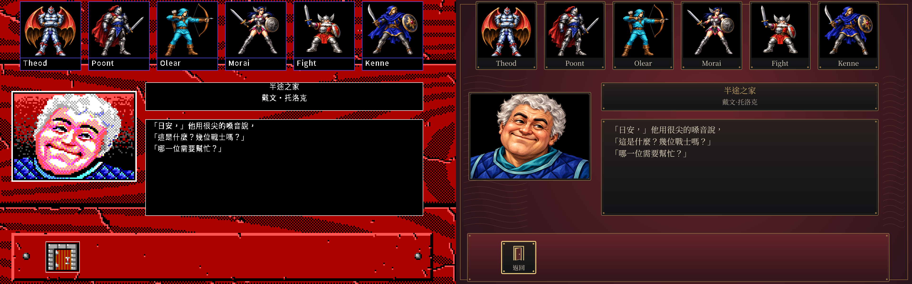
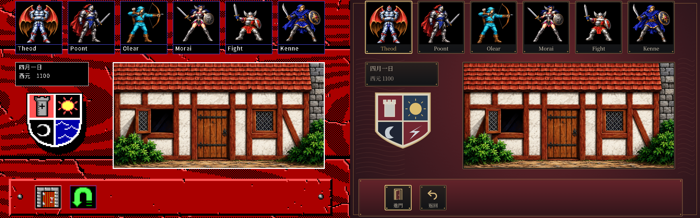
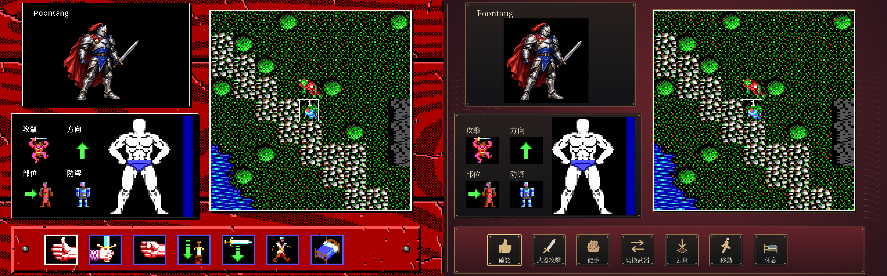

# HD 操作介面與人物頭像正式驗收

使用者核准[同主題原型](hd-ui-theme-20261012/review.html)並回覆「ok 同意開工」後，
依[SPEC-039](../spec/039-hd-art-ui.md#操作介面與人物頭像候選)接入正式Go呈現。
此批有限CONFORMED，按[SPEC-040](../spec/040-controlled-scene-acceptance.md)驗對應場景、中文與操作。

## 已接入

- 1920×1200原生HD的紅黑底、銅框、隊伍卡、日期、標題、對話、七個戰鬥指令及F10設定。
- 核准的六人與旅店門面保持原檔；旅店老闆以原圖RGB指紋匹配才換頭像。
- Noto Serif CJK TC字模含2,610字；現行2,608字完整涵蓋，原型250字的像素與字距完全相同。
- 面板及圖示由核准Canvas函式重生PNG，runtime不載字型檔、原版archive或瀏覽器。
- 同一場景按F10即時切換。EGA設定沿現行樣張；HD設定採本次核准樣式，v3格式保持。

| 驗證 | 結果 |
|---|---|
| 七條既有路徑 | 71個狀態，EGA／HD trace與中文紀錄逐份相同 |
| EGA回歸 | 可比的封存EGA畫格逐檔相同，數目見收據各路徑 |
| 正式場景 | 旅店門面、六人、老闆對話及戰鬥規劃已目視核對 |
| 真實鍵鼠 | F10、滑鼠、鍵盤、右鍵、1920×1200與960×600視窗通過；15個切換事件未改遊戲狀態 |
| 正常存讀檔 | 切換／未切換的GUI住宿保存只差saved_at；兩份存檔另起程序重載一致，EGA／HD一致 |
| 素材負例 | 缺頭像、破損圖示、缺字型授權、字格越界及重疊均拒絕；GUI缺整包保留EGA及中文錯誤 |
| 程式回歸 | Go正式全回歸、分層檢查、sceneverify與最後修改相關測試通過 |

入口為[完整收據](hd-interface-runtime-20261012/receipt.json)、[PNG清冊](hd-interface-runtime-20261012/manifest.json)
與[本機保存清冊](local/hd-interface-runtime-20261012/retention.json)。
場景驗證工具為`tools/verify_hd_interface.py`，鍵鼠工具為`tools/verify_display_switch.py --hd-interface`，
重載與封存為`tools/seal_hd_interface.py`。既有封存輸入取回方式沿`tools/verify_hd_first_slice.py prepare`。
工具在`kol-package:1.26.7-ebiten2.9.9-20261011-r1` Docker內執行，專案掛`/src`，本輪工作區掛`/out`，
圖形驗證使用有界Xvfb；命令、程式及二進位雜湊保存於收據與壓縮證據。

## 同主題比較

左側為先前首批HD，右側為本批正式介面。兩側用同一場景、六人圖集與門面，沒有重新選人物造型。

## 範圍

傷勢人形、狀態圖碼、地圖與未繪圖示保留現有顯示。資料頁、編輯器、清單、輸入游標與超長對話沿原畫面，
避免核准範圍外的資訊被遮蔽。其他NPC、組合裝備、書本與後續美術仍開放。
戰鬥沿封存seed1、鎖血、20倍傷害及原輸入，屬受控場景；沒有新增原版抽樣、嚴格parity或平台真機驗收。
截圖依private GitHub PNG特例保存，不取得公開散布權。

本批為開發版；現行`v.1.0.1-20261012`交付保持原內容。配樂另見[室內樂試聽](hd-music-20261012/review.html)，
技術檢查通過、人耳待確認，不在本次介面CONFORMED範圍。
