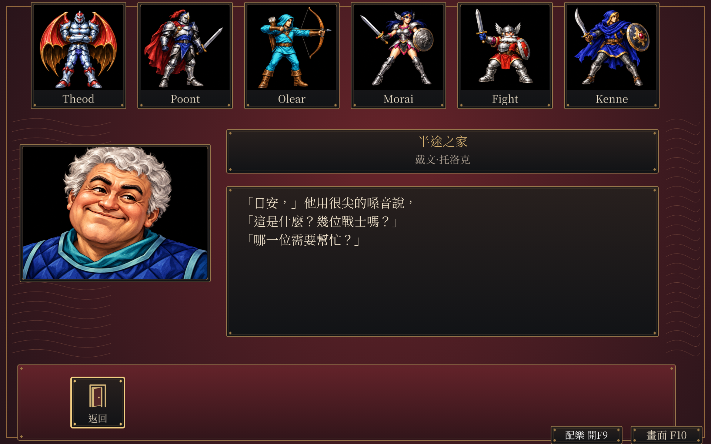

# HD 原創配樂接入

使用者接受標題、旅店、探索與戰鬥四首室內樂，並選定獨立配樂開關。開發版預設播放，F9與下緣「配樂」按鈕可切換；EGA／HD切換時持續播放。開關只在本次遊玩有效，人物v3格式保持。

狀態：**有限CONFORMED**。四首正式接入與已列場景通過。契約見[SPEC-004](../spec/004-ogg-audio-catalog.md#遊戲內配樂接入)，正式資產見[音訊目錄](../../assets/audio/hd/manifest.json)，完整來源與差分見[收據](hd-music-runtime-20261013/receipt.json)。

| 曲目 | 使用場景 | 長度 |
|---|---|---|
| 遠路與盟誓 | 標題 | 72秒 |
| 半途之家 | Halfway House旅店與整理子頁 | 80秒 |
| 林地與遠路 | 世界探索 | 90秒 |
| 謹慎交鋒 | 遭遇、戰場與撤退確認 | 60秒 |

四首為本專案原創MIDI，使用FluidR3 GM音色庫渲染為OGG，沒有取樣原作旋律。曲目原檔、音符、分軌、三輪試聽與授權見[標題／旅店](hd-music-20261012/review.html)及[探索／戰鬥](hd-adventure-music-20261013/review.html)。[控制比較](hd-music-control-20261013/review.html)保留核准的A案。

播放器完整驗四首的SHA-256、實際格式、聲道、取樣率與時長，再一次啟用。缺件拒絕整包、顯示中文提示並保留遊戲，可用F9重試。原有雷聲與完成閘門保持獨立；場景切換約0.3秒淡入淡出，配樂不消耗遊戲亂數。

驗證工具為[音訊輸出](../../tools/verify_music_runtime.py)及[玩家路徑](../../tools/verify_music_player_paths.py)。均在Docker使用隔離PulseAudio空裝置錄下Ebitengine／Oto實際輸出，不使用主機音訊裝置。

| 驗證 | 結果 |
|---|---|
| 正常標題 | 首輪23次雷聲、配樂實際跨72秒循環、離開後最後一秒靜音 |
| 正常旅店 | 配樂實際跨80秒循環；鍵盤F9、1920／960視窗滑鼠及EGA／HD切換通過；遊戲狀態雜湊保持 |
| 世界至戰鬥 | 準備世界存檔後，正常方向鍵與確認抵達遭遇／戰場；兩首有實際輸出，F9／F10不改戰鬥狀態 |
| 住宿保存 | 配樂關閉與開啟的正常住宿v3，除saved_at外完全相同 |
| 新程序重載 | 七個狀態與中文紀錄完全相同；HD字緣最大差一色階，逐圖差分列於收據 |
| 缺件 | 中文提示、F9重試、F10可用；實際輸出完全靜音 |
| 解碼與循環 | 四首SHA、聲道、取樣率及實際時長通過；循環讀取跨兩輪PCM完全符合原檔 |
| 回歸 | 全部cmd／internal套件及sceneverify標籤測試通過 |

[四畫面接觸表](hd-music-runtime-20261013/music-contact-sheet.png)包含旅店、準備世界、戰場與缺件提示。中文、圖像與按鈕目視通過；PNG來源、尺寸、SHA-256與private權利分類見[清冊](hd-music-runtime-20261013/manifest.json)。控制按鈕沿核准字模、標籤與座標；瀏覽器Canvas與Ebitengine字緣取樣有色差，幾何在一像素內，不宣稱兩者逐像素相同。

軟體繪圖下，實際音訊進度可能晚於牆鐘預估。循環以播放器位置確認，靜音等待淡出與裝置佇列排空後量測。旅店辨識改用已驗證的TWN7PICS圖號12，避免中文翻譯改寫標題後漏播。工具的視窗等待、離開時放鍵與世界批次準備錯誤均已修正；沒有改遊戲規則或亂數。

重跑使用`eob-audio-capture:20261009-r3`，專案唯讀掛`/src`、本輪輸出掛`/out`，UID/GID1000、無網路、3GiB、2CPU、256程序與外層逾時。啟動Xvfb及隔離PulseAudio後執行上述兩支Python工具。完整啟動腳本、原始WAV與日誌保存在[本機壓縮證據](local/hd-music-runtime-20261013/retention.json)，核對及還原沿[保存流程](retained-evidence.md)。WAV不進runtime或Git。

本輪屬開發版接入。既有v.1.0.1-20261012、三平台封包與推廣影片保持；本輪不新增原版抽樣、嚴格parity或平台真機聲明。
