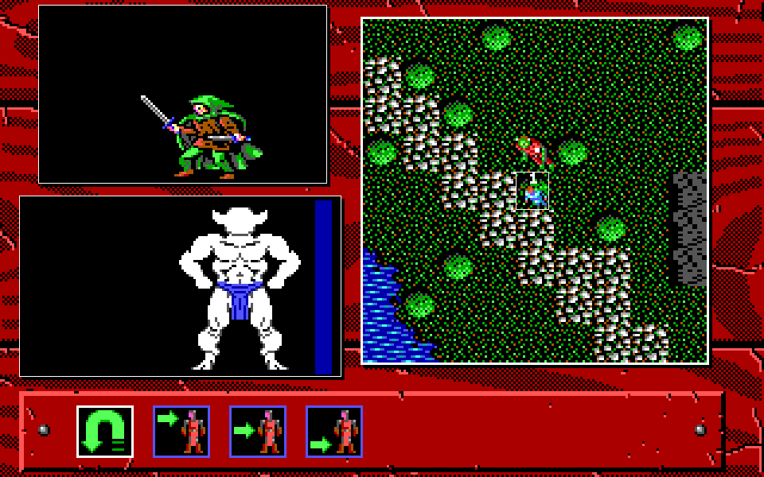

# v1.0.5 試玩回報修正驗證

日期：2026-10-24。開發版修正已通過本頁範圍的測試及 Linux 容器畫面驗證。
正式發行包仍為 v.1.0.5-20261018，本輪沒有建立版本、打包或發布。
規格與原版位址證據見 [SPEC-041](../spec/041-player-feedback-fixes.md)。

## 修正與結果

| 回報 | 處理及驗證 |
|---|---|
| 重啟遺失自建角色或回到預設隊伍 | 互動入口自動讀回保存目標。實際建立 aBcD、ZyX，住宿各扣 60 金幣，再開新程序，不加 `-load`／`-save`，兩人及各 1440 金幣保持 |
| 騎馬遇敵問句方向鍵無效 | 問句、圖示列與城門選單接受方向鍵；逗號／句號仍有效。問句圖示可點選，測試涵蓋騎走 YES／NO 游標切換 |
| 人物／裝備頁無法按數字換人 | 1..6 切換目前頁面的人物，保留戶外／野外返回宿主與裝備選中列。送禮等動作等待不改用途；實際雙人頁面通過 |
| 無法切換命名大小寫 | 名稱收文字事件，實際 Shift 輸入與保存中的 aBcD、ZyX 保持 |
| 販賣圖示無反應 | 原圖示 11 原先漏接。補背包清單、物品確認、店家收購上限、入帳與清槽；雙語實際點第二件毛皮上衣，顯示售價 185 並完成交易 |
| 鐵砧無反應 | 既有護甲調整流程可達；雙語實際操作過大毛皮帽，負重 200 改為 6。武器店鍛造仍受 RE-134 的原版資料限制 |
| 法術清單點選無效 | 商店、訓練、招募、法術共用清單點選；補法術欄位及選項目標。另補英文漏畫的選項框。雙語實際開修改法術、點種族欄與選項 |
| 攻擊後直接問防禦 | 補武器攻擊的上／中／下段等待層；受控戰鬥經正式選目標、攻擊式、部位、防禦及寫回。瘋狂攻擊保持跳過部位／防禦的原版規則 |
| 地圖方向長按不連走、滾輪跳過敵人 | 地圖採有初始延遲的連走，等待頁出現後須放開再按。滾輪不確認遭遇、通知、紮營與戰鬥執行；實際長按及防穿透測試通過 |



## 驗證方法

- Docker image：`kol-package:1.26.7-ebiten2.9.9-20261011-r1`，Go 1.26.7、Ebitengine 2.9.9。
  無網路、UID/GID 1000:1000、4 GiB、2 CPU、512 程序；工作有外層逾時。
- `go test ./cmd/... ./internal/...` 全部通過，含素材深驗、保存、規則、輸入、分層及 UI。
  原版 oracle 的條件測試未提供外部輸入，不算原版對拍。
- [鍵鼠驗證工具](../../tools/verify_feedback_gui.py)：Xvfb、X11 實體鍵鼠事件與 FFmpeg 抓圖。
  片頭音效送容器的 ALSA null 裝置，不作音訊聆聽驗收。
- [戰鬥驗證工具](../../tools/verify_feedback_battle.py)：使用 `sceneverify` 建置與 SPEC-040。
  固定 seed 1，任務 4 改為一名相鄰 Ruffian、鎖血，只走規劃選單，不比較原版亂數。
- [收據](player-feedback-20261024/receipt.json)鎖定程式、工具、來源、PNG 及測試雜湊。
  [鍵鼠收據](player-feedback-20261024/gui-receipt.json)與
  [戰鬥收據](player-feedback-20261024/battle-receipt.json)保留命令、操作及限制。

## 重生及限制

在上述 image 中唯讀掛儲存庫至 `/repo`，另將空白可寫輸出掛至 `/out`。
先以 `GOWORK=off` 及容器內鎖定 module cache 建置兩個執行檔，再執行：

```sh
cd /repo
export PATH=/usr/local/go/bin:$PATH
export GOWORK=off GOTOOLCHAIN=local GOPROXY=off GOSUMDB=off
export GOMODCACHE=/go/pkg/mod GOCACHE=/tmp/kol-go-cache
go build -buildvcs=false -o /out/kol ./cmd/kol
go build -tags sceneverify -buildvcs=false -o /out/kol-sceneverify ./cmd/kol
python3 -B tools/verify_feedback_gui.py --bin /out/kol --out /out
python3 -B tools/verify_feedback_battle.py --bin /out/kol-sceneverify --out /out
```

驗證工具要求 Docker，GUI 子目錄必須不存在；初始存檔與場景都寫在隔離輸出。
正式建置不含鎖血、位置準備或額外數值。kol-save-v3 與素材格式保持。
護甲及法術使用明示的受控保存，不能當作自然遊玩取得裝備或教派的證據。
這次沒有 Windows／macOS 真機、新 AppImage、HD 專項或完整原版 parity 驗收。

完整本機證據、失敗的環境／場景準備紀錄及重建程式雜湊見
[保存清冊](local/player-feedback-20261024/retention.json)。
依 [既有保存工具](retained-evidence.md#在-docker-內核對)核對後，清理本輪工作目錄。
