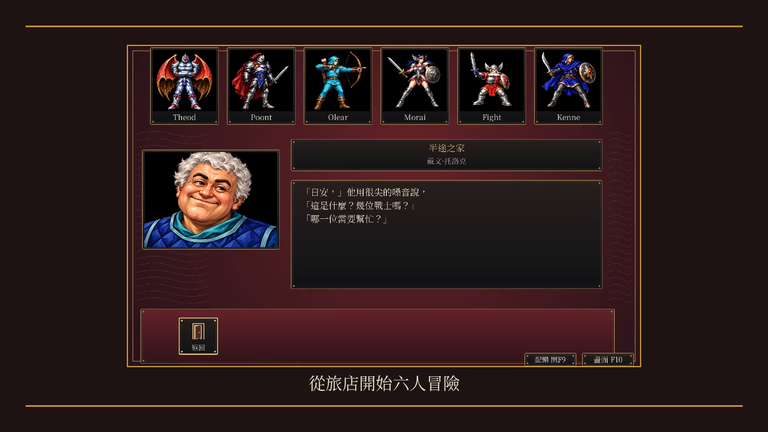

# v.1.0.3-20261017 全量HD交付

狀態：PASS，六包與76秒影片驗收完成，private Release四附件準備發布。完整結果與遠端狀態見[交付收據](release-v1.0.3-20261017/receipt.json)。前版tag、Release及產物保持。

本版納入目前玩家路徑13類HD圖形與操作介面，包含片頭、翻書、人物、完整裝備、七城與世界、戰場、天候、傷勢、事件及結局。沿核准手繪、1920×1200與同場景F10；四首原創室內樂及獨立F9保持。後續新遊戲圖片最長邊768，舊核准素材保留。正式規則、角色數值、原地圖與kol-save-v3未改。

## 交付

唯一現行交付根目錄為[dist-all/v.1.0.3-20261017/](../../dist-all/v.1.0.3-20261017/)。

| 平台 | 本機完整版 | 需匯入資料的引擎包 |
|---|---|---|
| Linux x86_64 | [AppImage](../../dist-all/v.1.0.3-20261017/full/kol-v.1.0.3-20261017-full-linux-x86_64.AppImage) | [AppImage](../../dist-all/v.1.0.3-20261017/release/kol-v.1.0.3-20261017-release-linux-x86_64.AppImage) |
| Windows AMD64 | [ZIP](../../dist-all/v.1.0.3-20261017/full/kol-v.1.0.3-20261017-full-windows-amd64.zip) | [ZIP](../../dist-all/v.1.0.3-20261017/release/kol-v.1.0.3-20261017-release-windows-amd64.zip) |
| macOS Intel／ARM64 | [Universal ZIP](../../dist-all/v.1.0.3-20261017/full/kol-v.1.0.3-20261017-full-macos-universal.zip) | [Universal ZIP](../../dist-all/v.1.0.3-20261017/release/kol-v.1.0.3-20261017-release-macos-universal.zip) |

完整版含本機遊戲資料、手冊、HD與OGG，只留本機。引擎包只有程式、工具、必要譯文、RRSAL-1.0與匯入清單，須依包內README.txt匯入合法持有且全部雜湊相符的1744份資源。原始ZIP／EXE／PDF及原始音訊不進交付包。

沿使用者已核准範圍，僅將三平台引擎包及SHA256SUMS.txt上傳[private GitHub Release](https://github.com/wicanr2/kol-remake-cht/releases/tag/v.1.0.3-20261017)。權利依[本版審查](../RELEASE-RIGHTS-REVIEW.md)。六包及影片的大小、SHA-256見交付收據與本機SHA256SUMS.json。
發布內文保存於[發行說明](../../dist-all/v.1.0.3-20261017/smoke/release-notes.txt)。

## 驗收範圍

| 項目 | 證據與判準 |
|---|---|
| 來源 | 與[完整HD驗收](hd-full-runtime-20261017.md)相同的430份Go／module、832份HD資產；[輸入清單](release-v1.0.3-20261017/build-inputs.json)逐檔記錄雜湊 |
| 回歸 | [完整cmd／internal測試](release-v1.0.3-20261017/checks.json)；vet兩則既有book.Label未具名欄位警示另留原紀錄 |
| 唯一正常抽樣 | 固定seed1，1046狀態／40PNG及13新程序重載／3PNG；完整trace相同，v3只排除saved_at；[收據](release-v1.0.3-20261017/sampling.json) |
| 完整HD | 同來源13場景、Linux及Wine各52畫格，含兩張地圖；中文與模型相同、缺字0，EGA零差、HD最多1／255，往返保持；[比較收據](release-v1.0.3-20261017/hd-scenes-comparison.json) |
| 實際封包 | Linux兩包匯入與正常六人旅店、F9／F10、兩種視窗鍵鼠、狀態及音訊；Windows兩個ZIP啟動、匯入、F9／F10及存檔保持；[Linux](release-v1.0.3-20261017/linux-controls.json)、[Windows](release-v1.0.3-20261017/windows-smoke.json) |
| 封包畫格 | 實際AppImage對Wine兩個ZIP共20組，EGA零差、HD最多一色階；Windows實際音訊非靜音、末段靜音；[收據](release-v1.0.3-20261017/windows-pixels.json) |
| 內容 | 六包版本、架構、ZIP CRC、1744資源、LICENSE、UTF-8檔名、可執行權限、macOS最低11.0／雙架構／ARM ad-hoc簽章及素材deny-list；[結構](release-v1.0.3-20261017/structures.json)、[逐包驗證](release-v1.0.3-20261017/packages.json) |

畫格按[SPEC-040](../spec/040-controlled-scene-acceptance.md)驗中文及正確場景。受控展示器不加入正式封包，也不修改正式隊伍數值。這些結果不代表原版parity、自然完成全部任務至結局，或Windows／macOS真機通過。

首次完整HD載入包含素材驗證與圖片準備，需要較長時間。限3CPU、軟體顯示的Linux容器約194秒才出現完整畫格，之後切換沿用快取。Windows首次12GiB容器在冷F10等待期限內未完成，觸及記憶體上限，無OOM kill；原紀錄保留，改16GiB且禁用swap重驗。這些是容器測量，不作真機效能或最低硬體需求。macOS只完成交叉編譯與結構檢查，主機FUSE未驗。

## 本版畫面

旅店及設定來自本版實際AppImage；戰場來自同來源受控展示。縮圖最長邊768，完整畫格留本機smoke。來源、原尺寸及前後SHA-256見[截圖清冊](release-v1.0.3-20261017/screenshots.json)。

| 同一旅店 EGA 設定 | 同一旅店 HD 設定 |
|---|---|
|  |  |

| 同一受控戰場 EGA | 同一受控戰場 HD |
|---|---|
|  |  |

事件與七段原版／HD結局比較保留在[README](../../README.md#事件畫面原版與-hd)，沿各批原始來源，不改標為本輪原版執行。

## 推廣影片

[76秒1080p影片](../../dist-all/v.1.0.3-20261017/promo/kol-v.1.0.3-20261017-promo.mp4)包含12幕：片頭、正常六人旅店、世界與城鎮地圖、雪景、戰場、傷勢、怪物、勝利及同場景EGA／HD設定。受控展示逐幕標明，使用核准四首原創室內樂與雷聲，影片只留本機。

H.264／AAC、1920×1080、25fps、76秒，峰值−5.6dB；沒有指定閾值的長黑幀或長靜音。靜態分鏡各5至8秒，12個解碼中心均不同。逐幕比例、中文、字幕邊界、受控標籤與版號已目視核對。來源見[影片清單](release-v1.0.3-20261017/promo-sources.json)、[媒體資訊](release-v1.0.3-20261017/promo-ffprobe.json)及[目視收據](release-v1.0.3-20261017/promo-visual-review.json)；完整偵測日誌在本機promo。

## 重現與保存

入口為[收尾流水線](../../tools/closeout_release.py)、[平台驗證](../../tools/verify_release_runtime.py)、[影片工具](../../tools/compose_release_promo.py)及[本版命令與步驟](release-v1.0.3-20261017/recipe/workspace/reproduction.json)。[工具映像身分](release-v1.0.3-20261017/tool-images.json)固定Go、macOS、Wine及音訊image；專案唯讀掛/src、輸出可寫掛/out，UID/GID1000:1000、無網路及有界資源。

[recipe](release-v1.0.3-20261017/recipe/)保存本版工具、展示器建置／檢查與文件同步腳本。展示器以主OS執行緒執行Ebitengine RunGame。封包原有工具快照與最終收尾工具雜湊分列於輸入清單。ZIP時間戳及容器時間不視為逐位元重建保證。

完整畫格、音訊、流程與各次失敗保留在本機smoke；精簡正式附件由[manifest](release-v1.0.3-20261017/manifest.json)索引。十份工作腳本逐檔核對保存後，已刪除本輪工作區與過期音訊socket；[清理收據](release-v1.0.3-20261017/cleanup.json)記錄雜湊與擁有權，其他工作區保持。歷程見[WORKLOG](../../WORKLOG.md)，唯一目前狀態見[CONTEXT](../../CONTEXT.md)。
