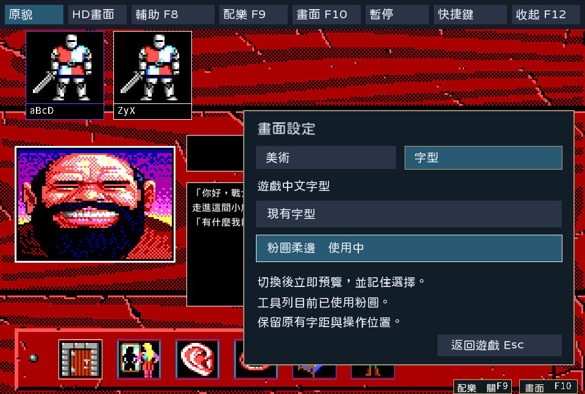
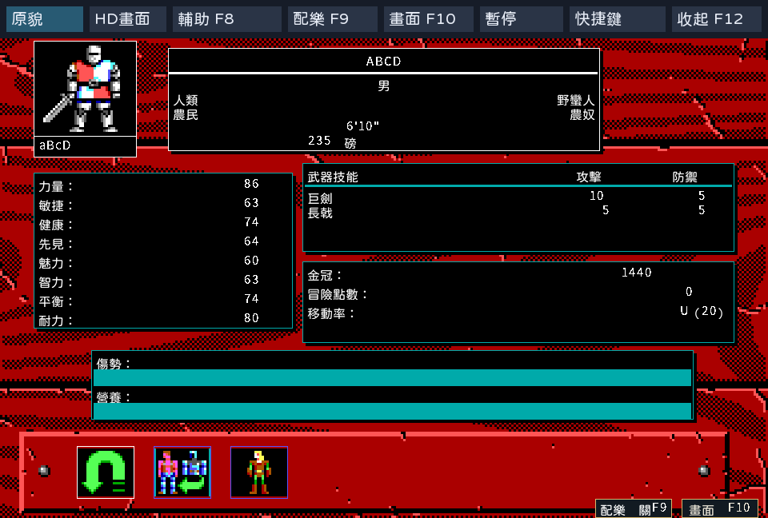
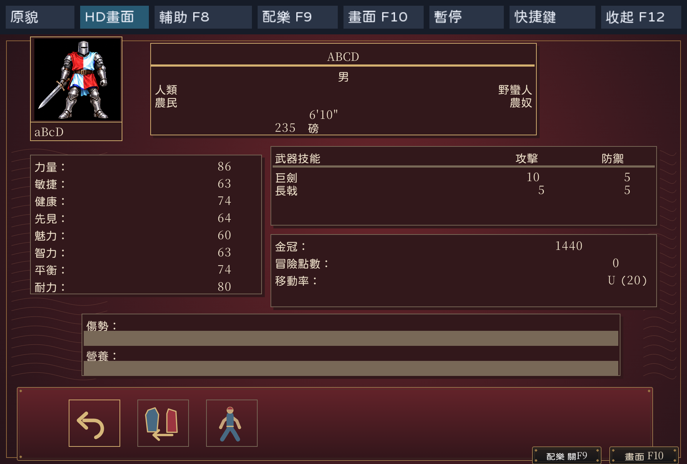

# 可切換粉圓遊戲字型驗收

日期：2026-10-24。結果：PASS，限定[SPEC-043](../spec/043-rounded-game-font.md)的呈現與偏好保存。
使用者已選定[原型](rounded-font-20261024/review/index.html)，正式實作沿其面板位置、比例、配色與字型。
這是開發版新增功能，既有v.1.0.7六包及影片未重建。

## 已驗證結果

| 項目 | 結果與證據 |
|---|---|
| 字型來源 | jf open粉圓2.1，與Zeliard相同的固定TTF；[來源清冊](../../cmd/kol/roundedfont/source.json)與[OFL授權](../../cmd/kol/toolbarfont/OFL.txt) |
| PNG字模 | EGA 16×18、HD 32×36；2,505字，缺字U+575F沿現有字模；第二次重生的四個檔案逐位元相同，見[可重現性](rounded-font-20261024/reproducibility.json) |
| 遊戲與介面回歸 | `go test -p 2 ./...`通過；最終載入失敗回復處理再跑font／ui／cmd三套件通過，見[完整日誌](rounded-font-20261024/tests.log)與[最終相關套件](rounded-font-20261024/tests-after-fallback.log) |
| 正常玩家路徑 | 固定seed1，正常建立兩名角色、選隊、招募、旅店住宿，每人由1500扣為1440；離開後新程序不帶-load續玩 |
| 互動設定 | 滑鼠、左右分頁、上下／Tab／Enter、Esc、收合工具列、英文模式均通過。設定期間遊戲鍵與長按方向不穿透，遊戲狀態雜湊保持 |
| 字型與存檔 | 預設現有字型；選擇保存於toolbar.json，舊偏好檔正常遷移，新程序沿用粉圓。切換字型不改save.dat，正常住宿仍依原流程保存 |
| EGA／HD | 960×648及1920×1296實際視窗、隱藏工具列960×600通過。旅店與真正的戶外人物頁均已驗；人物頁1／2切換可用 |
| 字距及還原 | EGA／HD旅店與人物頁字型往返後像素差均0。EGA人物姓名及屬性數字兩框像素差0；英文模式前後像素差0。見[比較收據](rounded-font-20261024/comparisons.json) |
| 編譯 | Linux ELF x86_64及Windows PE amd64通過；本輪只有Linux Docker/Xvfb操作驗收。沒有新增macOS或Windows真機驗收，見[建置清冊](rounded-font-20261024/builds.json) |

正式程式及兩組內嵌字模共461份輸入，逐檔SHA-256保存於[GUI收據](rounded-font-20261024/receipt.json)。
33張實際視窗PNG與[接觸表](rounded-font-20261024/contact-sheet.png)已目視核對；
[來源、擷取動作與雜湊](rounded-font-20261024/png-manifest.json)分開記錄，不把原型當正式畫面。
人物姓名、數字及英文字型保留原呈現；遊戲中文字距及行高沿原manifest，HD兩種文字入口均使用同一選項。

| EGA人物頁粉圓 | HD人物頁粉圓 |
|---|---|
|  |  |

## 重生與操作驗收入口

沿用映像`kol-package:1.26.7-ebiten2.9.9-20261011-r1`，image SHA-256為
`0b933af1238ab5839ad7a64b6ae05f069f57cb85da5917dfbe59730f6d7ba53f`。
使用UID/GID1000:1000、無網路、2CPU、192程序、4GiB，外層500秒上限；
儲存庫唯讀掛`/src`，既有可寫輸出目錄掛`/out`。掛載前先確認來源存在及擁有權。

- 字模：[產生工具](../../tools/bake_rounded_game_font.py)，以固定TTF執行
  `python3 -B /src/tools/bake_rounded_game_font.py --root /src --font /fonts/jf-openhuninn-2.1.ttf --out /out/font`。
  `/fonts`為事先確認存在的唯讀字型目錄；工具拒絕來源雜湊不同的字型。
- GUI：[操作工具](../../tools/verify_rounded_game_font.py)，先在同一Docker工具鏈建置正式程式，再執行
  `python3 -B /src/tools/verify_rounded_game_font.py --root /src --bin /out/kol --out /out/gui`。
  `/out/gui`不可已存在。程式啟動自身Xvfb並在finally結束；不依賴原版oracle或場景注入。
- 原始錄入、驗證日誌、早期腳本結果與執行檔完整保存於[本機清冊](local/rounded-font-20261024/retention.json)，
  核對與還原方法見[保存入口](retained-evidence.md)。

原版沒有中文字型選項，本輪不宣稱原版parity、所有動態文字已量測或三平台真機驗收。
既有完整版、影片、Release及tag保持。工作歷程及驗證腳本訂正只記錄於[WORKLOG](../../WORKLOG.md)。
